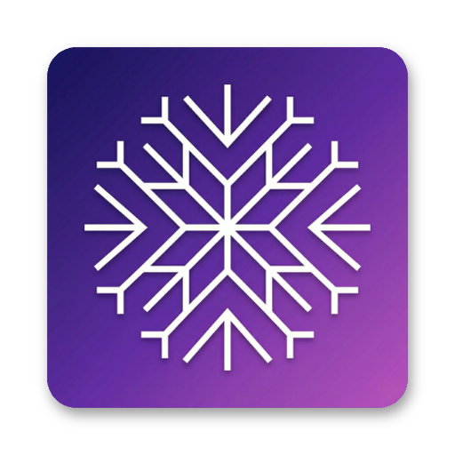 Fractal Note — Markdown・アウトライナー・データベース・マインドマップ、そしてすべてのファイルをひとつの場所に
=

**VS Code の中で完結するノートテイキング環境。** Fractal Note は **Notion ライクな WYSIWYG マークダウンエディタ** と **Dynalist ライクなアウトライナー( データベース / マインドマップ モードもあり) **をひとつのワークスペースに統合。さらに **ノートも書類も、すべてをひとつの場所で** — PDF・Word・Excel・PowerPoint などあらゆるファイルを、ファイルツリーに置くだけでなく **マークダウンにもアウトライナーのノードにも埋め込んで** 管理でき、**その中身までフルテキスト検索**できます。フォルダが増えすぎて「あの資料どこに置いたっけ」が始まっている人、**資料とメモが別々の場所に散らばって困っている人にこそ効きます。****Note** 単位で整理し、S3 に同期でき、そして **AI コーディングアシスタントとの共同作業** を前提に設計されています。


🌐 **Web サイト: [raggbal.github.io/fractal](https://raggbal.github.io/fractal/)** — VS Code が無くても使える **macOS のデスクトップ版** もあります。

📦 **インストール:** [デスクトップ版（macOS）](#デスクトップ版macos) ・ [VS Code 版](#vs-code-版拡張機能) ・ [AI エージェントの plugin](#ai-エージェントの-plugin) ・ [Web クリッパー（Chrome）](#web-クリッパーchrome-拡張)

---

## Fractal Note を選ぶ理由

- ✍️ **WYSIWYG Markdown** — 編集と閲覧を同時に。分割プレビューも生のマークダウン記法も不要。テーブル（Excel ライク編集・**セル結合にも対応**）、コードブロック、Mermaid、数式、draw.io — すべてリアルタイムにレンダリング。
- 🌲 **本格的なアウトライナー** — Dynalist / Workflowy スタイルのツリー編集。タグ管理、スムーズな絞り込み、そして **アウトライナー / データベース / マインドマップ** の3つのビュー。
- 📄 **サブページ** — アウトラインのノードやマークダウンページの子として、マークダウンページを埋め込み。Notion のデータベースのような階層的ドキュメントを構築できます。
- 🤖 **AI フレンドリーな設計** — 外部からのファイル変更を **リアルタイム** に画面へ反映。Claude Code、Cursor、Kiro にノートを編集させながら、自分の作業を続けられます。カーソル位置や編集中の内容は保持されます。
- 🗂 **Notes** — フォルダ（"note"）単位で情報を管理。ファイル自体はフラットに保存しつつ、表示上は仮想的なフォルダ/ファイルツリーで構造的に整理 — **任意のファイル添付**（PDF、Excel など）も含めて。横断フルテキスト検索は **添付した PDF / Word / Excel / PowerPoint と HTML / JSON などテキスト系添付の中身も対象**（ページ / スライド / シート!セルの位置表示 + 参照元 node へのバックリンク付き）。タブ・履歴管理、Daily Notes も。
- ☁️ **S3 バックアップ & リストア** — 自分の AWS S3 バケットへワンクリックでバックアップ、そこからのリストアも可能。
- 🧩 **エディタの外へ** — Web ページを取り込む Chrome 拡張、Amazon Translate 連携、そして AI エージェントが Fractal Note のノートを読み書きできる **AI スキル** を公開（Fractal Note を Obsidian の代わりに）。

`.md` と `.out` は単体（standalone）でも動作しますが、真価を発揮するのはすべてが繋がる **Notes マネージャ** です。

---

## 📦 インストール

使いたいものを選びます。どれも同じ note を使います:

| | 何か | どこから |
| --- | --- | --- |
| 🖥 [デスクトップ版（macOS）](#デスクトップ版macos) | VS Code が無くても使える単体のアプリ | [Apple Silicon 用 `.dmg`](https://github.com/raggbal/fractal/releases/latest/download/Fractal-mac-arm64.dmg) ・ [Intel 用 `.dmg`](https://github.com/raggbal/fractal/releases/latest/download/Fractal-mac-x64.dmg) |
| 🧩 [VS Code 版（拡張機能）](#vs-code-版拡張機能) | VS Code と互換のエディタの中で使う Fractal Note | [VS Code Marketplace](https://marketplace.visualstudio.com/items?itemName=imaken.fractal) ・ [Open VSX](https://open-vsx.org/extension/imaken/fractal) |
| 🤖 [AI エージェントの plugin](#ai-エージェントの-plugin) | Claude Code・Codex・Kiro が note を探して、読んで、書けるようにする | このリポジトリ（`agent-capability/install.sh`） |
| 🌐 [Web クリッパー](#web-クリッパーchrome-拡張) | Chrome・Edge から Web ページを note に保存する | このリポジトリ（`chrome-extension/`） |

同じ手順はアプリの画面つきで [Web サイト](https://raggbal.github.io/fractal/) にもあります。

### デスクトップ版（macOS）
VS Code が無くても使える、単体のアプリです。VS Code 版と同じコードで動くので、ノートの見た目も操作も同じです。

- Apple Silicon（M1 以降）または Intel の Mac、macOS 13 Ventura 以降
- Windows・Linux はまだ対象外

1. **dmg をダウンロードして開く** — Apple Silicon の Mac は [`Fractal-mac-arm64.dmg`](https://github.com/raggbal/fractal/releases/latest/download/Fractal-mac-arm64.dmg)、Intel の Mac は [`Fractal-mac-x64.dmg`](https://github.com/raggbal/fractal/releases/latest/download/Fractal-mac-x64.dmg) をダウンロードして、ダブルクリックで開きます（どちらか分からないときは、アップルメニュー →「このMacについて」で「チップ: Apple M…」なら Apple Silicon、「プロセッサ: Intel…」なら Intel です）。
2. **アプリケーションフォルダにドラッグする** — 開いたウインドウで、`Fractal.app` を「アプリケーション」フォルダにドラッグします。
3. **Fractal を開く** — 「アプリケーション」から Fractal を開きます。Apple の Developer ID で署名し、Apple の公証（notarize）も通しているので、macOS が「インターネットからダウンロードされたアプリ」の確認を 1 回出すだけです。**開く** を押してください。
4. **使いはじめる** — Fractal は note の一覧 `~/.fractal/default.fractal` を開きます。この Mac の VS Code 版と同じ一覧です。左のサイドバーからフォルダを note として足せます。

- **新しい版にする** — Fractal を終了し、新しい dmg をダウンロードして「アプリケーション」の `Fractal.app` を置き換えます。自動の更新はまだありません。版の一覧は [Releases](https://github.com/raggbal/fractal/releases) にあります。
- **設定** — **Fractal → Settings…** で `settings.json` が開きます。キーは VS Code 版と同じ `fractal.*` です（VS Code の設定は読みません）。
- **デスクトップ版でまだできないこと** — S3 の同期と翻訳、draw.io を外のエディタで開く、自動の更新。
- **消すとき** — `Fractal.app` を削除します。アプリのデータは `~/Library/Application Support/Fractal` にあります。ノートには触れません。

### VS Code 版（拡張機能）
VS Code と、その互換のエディタの中で使う Fractal Note です。macOS・Windows・Linux で動きます（ふだん確かめているのは macOS です）。

- **VS Code Marketplace**（Visual Studio Code）— 拡張機能のビュー（`Cmd+Shift+X` / `Ctrl+Shift+X`）で **「Fractal Note」** を検索して **インストール** を押します。[Marketplace で開く](https://marketplace.visualstudio.com/items?itemName=imaken.fractal) か、次のコマンドでも入れられます:
  ```bash
  code --install-extension imaken.fractal
  ```
- **Open VSX**（VSCodium・Cursor・Kiro・Gitpod・Eclipse Theia など、Open VSX Registry を使うエディタ）— エディタの拡張機能のビューで「Fractal Note」を検索するか、[Open VSX で開きます](https://open-vsx.org/extension/imaken/fractal)。
- **VSIX から** — [Releases](https://github.com/raggbal/fractal/releases/latest) から `fractal-<version>.vsix` をダウンロードして:
  ```bash
  code --install-extension fractal-<version>.vsix
  ```
- **ソースから**
  ```bash
  git clone https://github.com/raggbal/fractal
  cd fractal
  npm install
  npm run compile
  # F5 でデバッグモードで起動
  ```

### AI エージェントの plugin
**Claude Code・Codex・Kiro** が、ノート（アウトライン・Markdown のページ・添付）を探して、読んで、書けるようにする MCP サーバーと skill です。アプリと同じコードで動くので、画面で操作したのと同じ結果になります（[🤖 AI スキル](#-ai-スキル--fractal-note-をエージェントのノートに)）。

- Node.js 18 以降、git
- このリポジトリから作って入れます

1. **リポジトリを取ってくる**
   ```bash
   git clone https://github.com/raggbal/fractal && cd fractal && npm install
   ```
2. **plugin を入れる** — plugin を作り、見つかったエージェントすべてに入れます。Claude Code と Codex は plugin、Kiro は Power として入ります。Antigravity には手で設定するコマンドを表示します。
   ```bash
   agent-capability/install.sh
   ```
   一部のエージェントだけ: `--only claude,codex,kiro`。何をするかだけ見る: `--dry-run`。
3. **新しいセッションで使う** — 新しいセッションで tool（`fractal_search`・`fractal_get`・`fractal_add` など）が使えます（Claude Code は `/reload-plugins` でも）。たとえば「Fractal の今週の議事録をまとめて」と頼めます。

- **手で入れるとき** — リポジトリで `npm install` と `npm run build:mcp` をしてから:
  - Claude Code: `/plugin marketplace add <repo>/agent-capability` → `/plugin install fractal@fractal-local`
  - Codex: `codex plugin marketplace add <repo>/agent-capability` → `codex plugin add fractal@fractal-local`
  - Kiro: `kiro-cli powers install <repo>/agent-capability/plugin`（または Powers → Add Custom Power → Import power from a folder）
- **更新**（`git pull` のあと）: `agent-capability/install.sh --update`
- **外す**: `agent-capability/install.sh --uninstall`。詳しくは [agent-capability/README.md](agent-capability/README.md)

### Web クリッパー（Chrome 拡張）
任意の Web ページを note に保存します。VS Code を使わず、Chrome・Edge から直接（[🌐 Chrome 拡張](#-chrome-拡張web-クリッパー)）。

- Chrome か Edge（Chromium 系のブラウザ）
- デスクトップ版か VS Code 版の note の一覧（`.fractal`）
- Chrome ウェブストアにはまだ出していません。このリポジトリから読み込みます

1. **リポジトリを取ってくる** — ビルドは要りません。
   ```bash
   git clone https://github.com/raggbal/fractal
   ```
   git が無ければ、GitHub の **Code → Download ZIP** で zip を落として開きます。
2. **Chrome に読み込む** — `chrome://extensions` を開き、右上の **デベロッパーモード** を ON にして **パッケージ化されていない拡張機能を読み込む** を押し、リポジトリの `chrome-extension` フォルダを選びます。初回は設定が自動で開きます（あとから開くときは、クリッパーのアイコンを右クリック → **オプション**）。
3. **.fractal を選ぶ** — **📄 .fractal を選ぶ…** を押し、Fractal が使っている note の一覧（既定は `~/.fractal/default.fractal`）を選びます。`~/.fractal` は隠しフォルダなので、Mac はダイアログで **⌘⇧G** を押して `~/.fractal` と入力します。note は毎回そこから読むので、Fractal で足した note もそのまま出ます。
4. **note を有効にする** — Chrome は、拡張機能が書き込めるフォルダをあなたに選んでもらう決まりです。設定画面に選ぶフォルダが並ぶので（例 `~/workspace/fractal`）、その横の **選ぶ…** を押します。パスがコピーされ、フォルダを選ぶ画面が開きます（前に開いた場所で開きます）。**⌘⇧G** を押して **⌘V** で貼り付け、Enter、**選択** を押して、Chrome に聞かれたらファイルの編集を許可します。そのフォルダの中の note すべてが **✓ 保存できます** になります。`.fractal` に入っているほかのコンピューターの note（Mac での `/home/ec2-user/…` など）は「このコンピューターにはありません」と出て、対象外です。よく使う note は ☆ を押すと popup で先に出ます。
5. **クリップする** — 保存したいページでクリッパーのアイコンを押し、note と保存先（アウトライナーか Markdown のページ）を選んで **📌 Bookmark** を押します。**`Alt+Shift+F`** は popup を開かずに、最後に保存した場所に保存します。

- **新しい版にする** — `git pull`（zip なら新しい zip で置き換え）してから、`chrome://extensions` の Fractal Web Clipper の **↻** を押します。設定はそのままです。
- **消すとき** — `chrome://extensions` で **削除** を押します。note には触れません。
- 詳しくは [chrome-extension/README.md](chrome-extension/README.md)

### オプション: AWS 認証情報（S3 同期 & 翻訳）
コア機能は AWS なしで動作します。S3 同期と Amazon Translate を使うには、VS Code の設定で認証情報を設定するだけです（AWS SDK を内蔵しており、CLI のインストールは不要）。なお、HTTP(S) プロキシ経由の接続には現在対応していません:

- S3 同期: `fractal.s3AccessKeyId`, `fractal.s3SecretAccessKey`, `fractal.s3Region`
- 翻訳: `fractal.transAccessKeyId`, `fractal.transSecretAccessKey`, `fractal.transRegion`

---

## キービジュアル

### VS Code の中で
アクティビティバーの Fractal Note で .fractal の一覧と note を選ぶと、note がエディタのタブで開きます（note のツリー・アウトライン・サイドパネルのページ）。
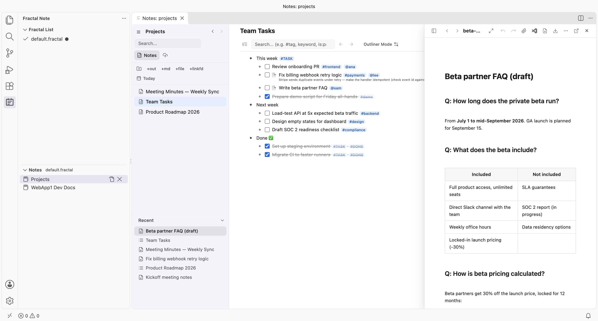

### マークダウンエディタ
Notionのような心地よい入力ができるMarkdown エディター。基本的なMarkdown要素は全て使え、さらに codeブロック、数式ブロック、mermaidブロック、drawio埋め込みブロック、文字色変更など拡張的な機能も存在。あらゆる人のMarkdownニーズに対応。
さらに、Notion的な Subpage も対応(Linkとは区別)。階層的に Markdown を管理することが可能。
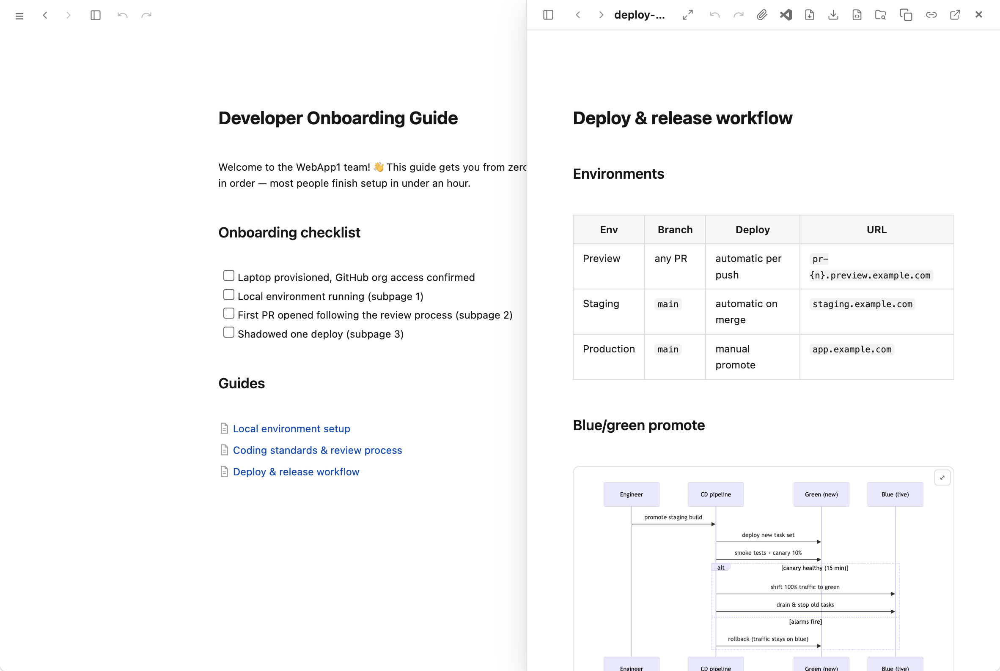

### アウトライナーエディタ
Dynalist クラスのアウトライナー。フォルダ、タグ、そしてアウトラインノードとマークダウン本文の横断フルテキスト検索。
同じアウトラインを **データベースビュー**（Notion 的なテーブル）と **マインドマップビュー**（編集可能な SVG マインドマップ）に切り替えて表示・編集することも可能。
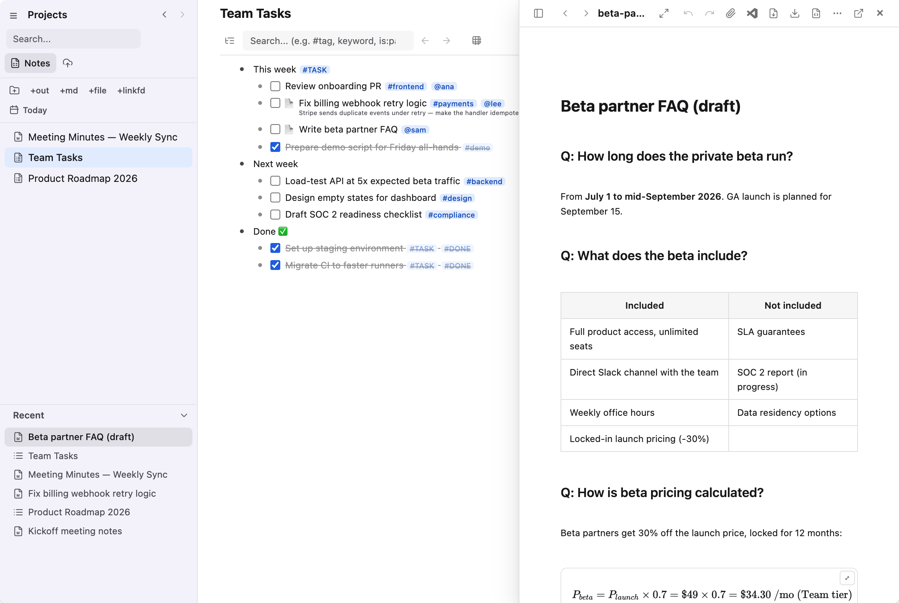


---

## ✨ コアコンセプト

**Notion のように、Markdown・Outliner・Database・Mindmap をひとつの場所で管理する。** Fractal Note では 4 つのコンテンツが別々のツールではなく、同じ note の中で繋がります — アウトラインのノードにマークダウンページをぶら下げ、同じアウトラインをデータベースやマインドマップとして眺め、すべてを横断検索する。しかもデータはプレーンな `.md` と JSON のままです。

| コンテンツ | 実体 | 概要 |
| --- | --- | --- |
| **Markdown** | `.md` | Notion ライクな WYSIWYG エディタ。ひとつのビューで編集と閲覧を同時に。サブページで階層化 |
| **Outliner** | `.out` | Dynalist ライクなツリー編集。タグ・タスク・検索 |
| **Database** | `.out`（ビュー） | 同じアウトラインを Notion ライクなテーブルとして表示。テキスト / タグ / 日付列 |
| **Mindmap** | `.out`（ビュー） | 同じアウトラインを SVG マインドマップとして表示・編集 |

これらを束ねるのが **Notes** — フォルダ単位のワークスペース（仮想ツリー、横断検索、タブ、Daily Notes、S3 同期）です。マークダウンページはマークダウンエディタからもアウトライナーからも開けます。サブページはデフォルトで **サイドパネル** に、または **新しいタブ** で独立ドキュメントとして開きます。

**あらゆるファイルを一箇所で、簡単に管理。** `.md` や `.out` だけでなく、任意のファイル（PDF、Excel、画像など）を note に添付でき、**note ツリー・アウトライナーのノード・マークダウンドキュメントの間を D&D やコピー/カット/ペーストのショートカットで自由に移動**できます。所有権は移動に合わせて自動で切り替わり、リンクは切れず、note を跨ぐ移動ではアセットも自動で複製 — 手作業のファイル管理は不要です。

---

## 📝 マークダウンエディタ (.md)
Notion スタイルの WYSIWYG エディタ。見えているものがそのままファイルの中身です。
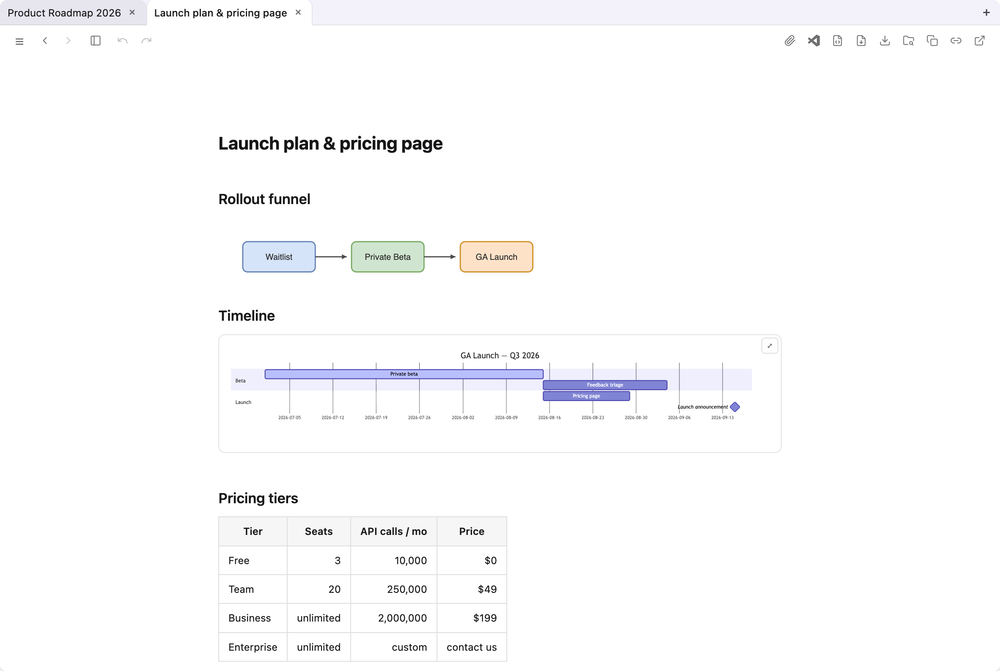
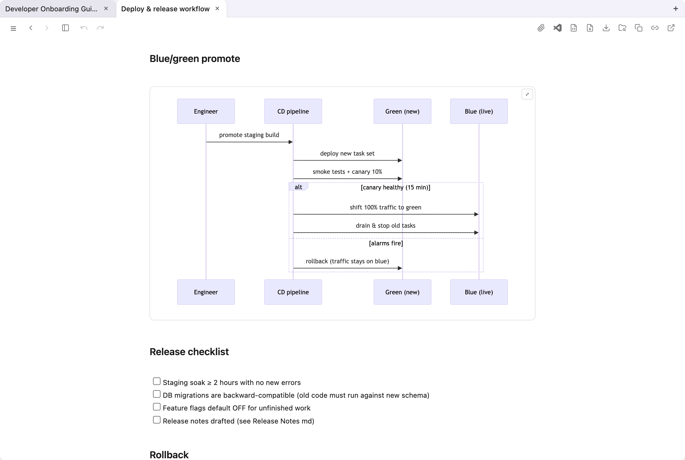


### 編集
- **シームレスなライブプレビュー** — マークダウンを書くと即座にレンダリング。いつでも **ソースモード** に切り替え可能（`Cmd+.`）
- **見出し、リスト、タスクリスト、引用、水平線** — 標準的なマークダウンをすべてキーボードファーストで
- **テーブル** — Excel ライクなセル選択: クリックでセルを選択、矢印で移動、Shift+矢印 / ドラッグ / Shift+クリックで範囲選択。cmd+c/x/v は表計算ソフトと相互運用（TSV + HTML の双方向）。Enter やタイプでセル編集、Tab で右へ（最終セルの Tab で行追加）。ツールバーからセルの結合/解除（マーカーコメント付きの GFM 互換マークダウンで永続化）、検索ボックスで行の絞り込み（表示のみ）、セル端ドラッグで列幅変更、ヘッダー行の ON/OFF 切り替え — すべて他のビューアと互換のマークダウンのまま
- **リスト内ブロック** — リスト項目の継続行（Shift+Enter）の中に引用ブロックやコードブロックを作成可能。`> ` / ` ` ``` の自動変換、パレット、ショートカットから作れて、マークダウンの往復でも保持されます
- **コードブロック** — 24以上の言語のシンタックスハイライト、VS Code のエディタタブへの展開
- **インライン書式** — 太字、斜体、取り消し線、インラインコード、スマートリンク作成
- **アクションパレット**（`Cmd+/`） — すべての書式・挿入アクションを検索可能なメニューに集約

### 添付とメディア
- **画像** — ペーストまたはドラッグ&ドロップ。ピンチズーム・パン対応のフルスクリーンライトボックス。表示幅の上限は設定可能
- **ファイル添付** — 任意のファイル（PDF、Excel など）をドロップすると `[📎 filename](path)` リンクを挿入。クリックで開く — Office（Word / Excel / PowerPoint）・PDF・HTML・画像・テキスト/コード系はアプリ内ビューアで、それ以外は OS デフォルトアプリで。リンクにはファイル種別アイコン（📕 pdf / 📘 doc / 📗 xls / 📙 ppt / 🌐 html）が付きます。リンクテキストは他のリンク同様に編集可能で、全選択して copy/cut すると**リンクごと**移動・複製でき、📎 アイコンのドラッグで md 内移動やツリーへの移動も可能
- **添付パネル** — ドキュメント内で参照しているすべての画像・ファイルを一覧表示。Open / Copy Path 付き

### PDF エクスポート
- **ワンクリックで PDF** — ツールバー / サイドパネルのボタン（または `Fractal Note: Export to PDF`）で、開いている md をエディタ表示そのまま（Mermaid・数式・文字色・チェックボックス込み）の印刷向け PDF に変換
- **スマートな改ページ** — 既定で h1/h2 の前に改ページ。ただし最初の h1 と、各 h1 直後の最初の h2 の前には入れない（章立てが自然に組まれる）
- **CSS でカスタマイズ** — `fractal.pdfStyles`（CSS ファイルパスの配列）で組み込みスタイルを上書き。`fractal.pdfIncludeDefaultStyles: false` で完全差し替えも可。改ページは素の CSS（`break-before`）なので自由に無効化・拡張できる
- **ローカル完結・依存ゼロ** — インストール済みの Chrome/Edge を headless 利用。エクスポート中の外部通信なし・拡張本体への追加依存なし

### Export bundle — ドキュメントを note の外へ持ち出す
Notes はファイルをフラットに置き note 相対リンクで繋ぐため、`.md` を 1 枚だけ手でコピーすると画像やサブページのリンクが切れます。**Export bundle** はすべてを 1 つの可搬フォルダにまとめます:
- アウトライナーの node を右クリック（または md ページのサイドパネルボタン）→ **Export bundle**
- そのページに加え、**サブページ（再帰）・リンク先ページ・画像・添付ファイル**を 1 フォルダにコピーし、リンクをすべて自己完結に書き換え — 共有・公開・他ツールへの持ち込みにそのまま使える

### 図と数式
- **Mermaid** — インラインでレンダリング、クリックでソース編集
- **KaTeX 数式** — ディスプレイモードの数式をライブ再レンダリング

### draw.io 埋め込み

VS Code を離れずに draw.io の図を作成・編集できます。

- **作成** — `Cmd+/` → **Insert Drawio Diagram** で空の図を生成し、カーソル位置に画像として挿入。既存の `.drawio.svg` / `.drawio.png` のドラッグ&ドロップにも対応
- **ファイル形式** — 保存されるのは `.drawio.svg`（本物の SVG に draw.io の編集データを内蔵した形式）。GitHub でもそのまま画像表示でき、任意の draw.io クライアントで再編集できます。ドキュメントには通常の `` 画像として埋め込まれるので、他のマークダウンエディタとの互換性も保たれます
- **編集** — 図にホバーすると 3 つのボタンが表示されます:
  - **Open in VS Code** — VS Code のタブで開く。[Draw.io Integration 拡張](https://marketplace.visualstudio.com/items?itemName=hediet.vscode-drawio)（hediet.vscode-drawio）をインストールしていれば、タブ内でそのまま draw.io エディタが開きます（おすすめ）
  - **Open in External** — 外部アプリで開く。draw.io Desktop がインストールされていればそれを優先起動、無ければ OS のデフォルトアプリで開きます
  - **Copy Path** — 絶対パスをクリップボードへ
- **自動再レンダリング** — どの方法で編集しても、保存した瞬間に開いているドキュメント内の図が自動で再描画されます。エディタを往復するだけのシームレスな編集ループ

### サブページ
Notion のように、md の中に md を埋め込めます。サブページは単なるリンクではなく **親ページに所有される**存在で、その所有関係は親にどこまでもついて回ります:
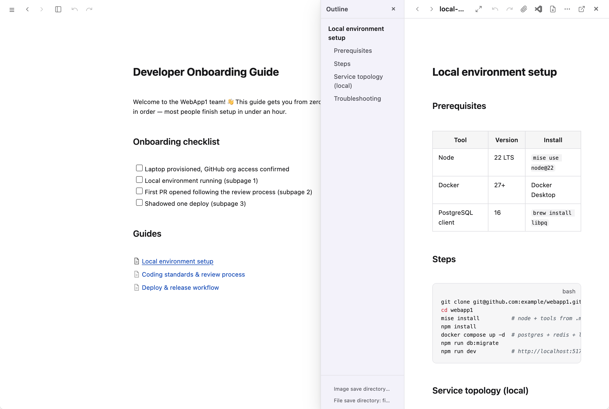

- `Cmd+/`** → Add Page**（または `Cmd+N`） — 子マークダウンページを作成してカーソル位置にリンクを挿入
- `.md` リンクをクリックすると **Notion スタイルのサイドピークパネル** で開き、フル WYSIWYG 編集が可能。戻る/進むナビゲーション付き（`Opt+←` / `Opt+→`）
- `Cmd+Shift+クリック`（Windows / Linux: `Ctrl+Shift+クリック`）で **新しいタブ** に開く — 同じ修飾がファイルツリーの行（行のどこでも）とアウトライナーの 📄 / 📎 アイコンでも効きます。右クリックの **Open in new tab** でも同じ
- ページの中にページ — いくらでも深い階層を構築できます
- **サブページは親と一緒に動く** — 親を複製すると（ノードのコピー&ペースト、note を跨ぐペースト、"Move to Other Note"）、サブページも画像・添付ごと一緒に複製・移動され、リンクも書き換わるので何も壊れません。親を削除して孤立したサブページは Clean Unused Files が回収します

### AI フレンドリー: 外部変更のリアルタイム同期
AI アシスタント（Claude Code、Cursor、Kiro など）— あるいは他の何か — が開いているファイルを変更したとき:

- **ブロックレベルの DOM 差分** — 変更されたブロックだけをパッチ。カーソル位置と編集中の内容は保持
- 自分の編集と AI の編集が、ひとつのドキュメントの中で **安全に共存**
- `Cmd+L` — 選択テキストを AI チャットへ送信。`Cmd+Shift+.` で VS Code のテキストエディタとして開く

### スタンドアロンモード
- Fractal Note を `.md`** のデフォルトエディタ** に設定すれば、マシン上のあらゆるマークダウンを編集可能 — note ワークスペースは不要
- スタンドアロンのファイルでは **画像・添付ファイルの保存先フォルダを指定可能**（ファイルの隣の隠しファイル `.fractal.json` に保存 — マークダウン本文には一切手を加えないため、他のエディタからは見えません）

---

## 🌲 アウトライナー (.out)
Dynalist ライクなアウトライナー。同じデータを3つの視点で。

#### アウトラインビュー
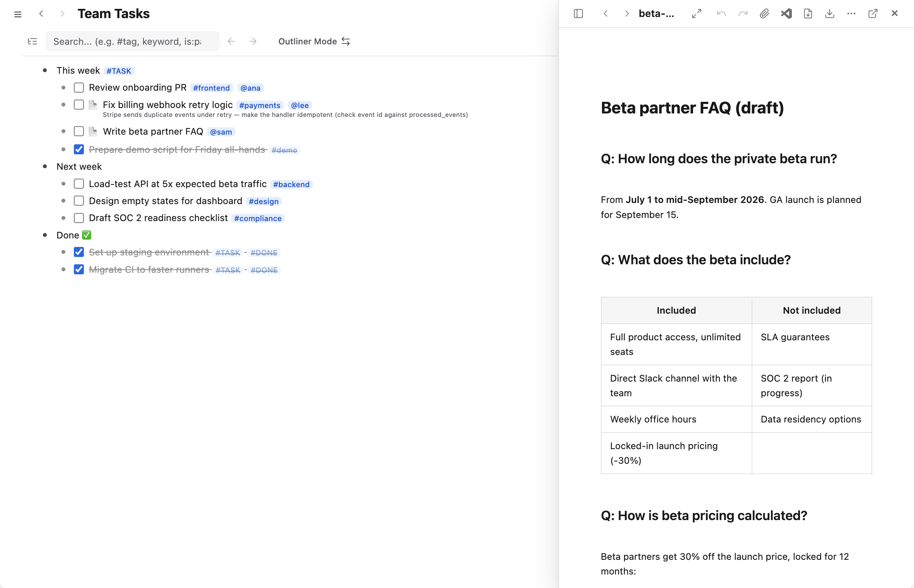

#### データベースビュー
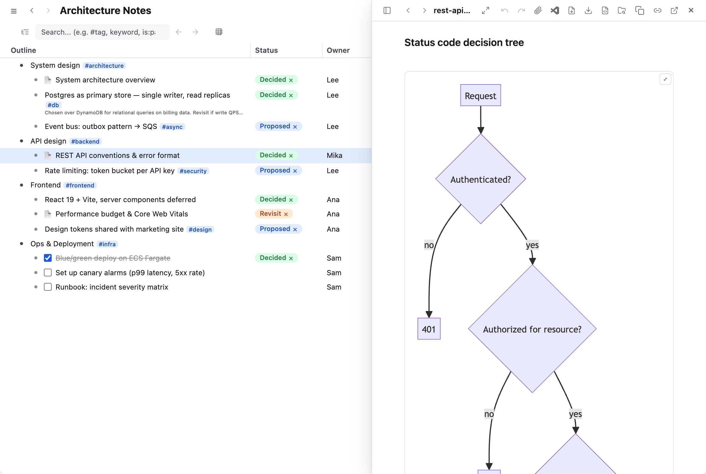

#### マインドマップビュー
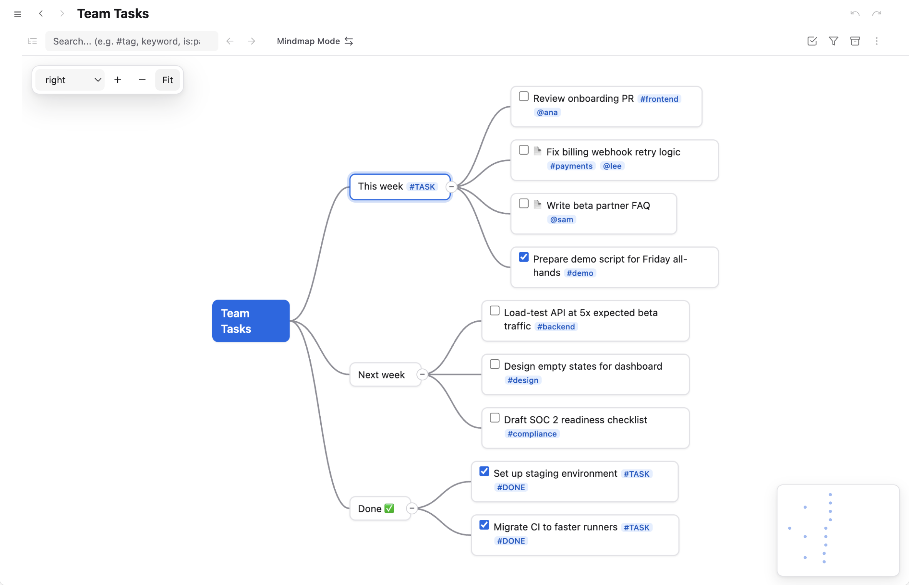

### 3つのビューモード
ビュートグルで切り替え:

1. **アウトライナービュー** — クラシックなバレットツリー。無制限のネスト、折りたたみ/展開、パンくず付きのサブツリースコープ
2. **データベースビュー** — アウトラインを Notion ライクなデータベース（ツリーテーブル）として表示。テキスト / タグ（マルチセレクト）列に加え、ネイティブの日付ピッカー付き **Date / Date & Time 列** を追加可能
3. **マインドマップモード** — 同じ `.out` を SVG マインドマップとしてレンダリング。放射 / 左 / 右 / バランスの4レイアウト、キーボード中心の編集（ナビゲーション・兄弟/子追加・入れ替え・タイプで即編集・子孫込みのコピー/カット/ペースト）、ノードの色・シェイプ変更、境界（グループ）、関係線 — さらに画像の添付/削除、📄/📎 ノードと note ツリー・マークダウンエディタ間の双方向ドラッグ&ドロップ

### タグと検索で整理
- `#tag` と `@tag` は自動でハイライトされ、クリックで即絞り込み
- **ピン留めタグ** — よく使うタグをワンクリックフィルタに
- **Dynalist 互換の検索** — AND、OR、NOT、`"フレーズ"`、`#tag`、`in:title`、`has:children`、`is:page`、`is:task` — スムーズなインクリメンタル絞り込み

### 何でも添付
- **マークダウンサブページ** — 任意のバレットをページ化（`@page`）し、サイドパネルのフル WYSIWYG エディタで編集。**Notion のデータベース** のように階層的なマークダウンを管理
- **画像** — `Cmd+V` でペースト。ノード下にサムネイル表示、ドラッグで並べ替え、ダブルクリックで拡大
- **ファイル** — 任意のファイル形式をノードに添付。📎 ノードは Office / PDF / HTML / 画像 / テキストをアプリ内ビューアで、それ以外を OS デフォルトアプリで開く
- `.md`** インポート** — Notion / Obsidian のエクスポートをページノードとして取り込み。画像は自動コピーされ、パスも書き換え
- **フォルダをまるごとインポート** — 任意のフォルダを選ぶと中身がそのままノード階層になります: サブフォルダはノード、`.md` はページノード、それ以外は 📎 添付。ファイルは **note にコピー**される（参照ではない）ので、アウトラインは自己完結します。隠しエントリとシンボリックリンクはスキップ
- **フォルダに書き出し** — その鏡像の操作: 任意のサブツリーを**実物のフォルダとファイル**として書き出します。子を持つノードはフォルダ、末端ノードは `<ノードのテキスト>.md` かその添付になり、ノード自身の添付はそのフォルダ直下に置かれます。宛先の既存ファイルは決して上書きしません（連番を付けます）
- **ノードの右クリック**からも Import / Export folder を実行できます（≡ ヘッダメニューにもあり）— 右クリックしたノードが対象になります

### タスク
- `- [ ]` / `- [x]` チェックボックスと充実したキーボード操作（`Cmd+Shift+X` でトグル）
- **タスクモード** — 新規ルートノードが自動でチェックボックス化
- **タスクフィルタ** — 完了済みサブツリーをワンクリックで非表示
- **Daily Notes へのアーカイブ** — 完了タスク（ページ・画像・ファイルごと）を今日の Daily Note 配下へ移動し、`#TASK #DONE` タグを付与

### 編集の基本
Enter / Tab / Shift+Tab は期待どおりに動作。複数選択インデント、ノード移動（`Cmd+Shift+↑/↓`）、サブテキスト（`Shift+Cmd+Enter`）、インライン書式、クリック可能なリンク、ナビゲーション履歴（`Opt+←/→`）、完全な Undo/Redo。詳細は下の「主なショートカット」参照。

---

## 🗂 Notes — すべてが繋がる場所

Fractal Note は **note** 単位で情報を管理します。アクティビティバーから任意のフォルダを登録するだけです。
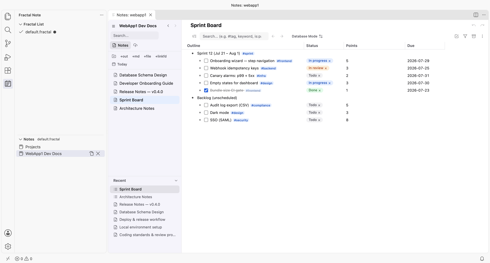

- **ロックインのない構造化** — ファイルはディスク上に **フラット** に保存しつつ、`.out`・`.md`・**その他任意のファイル** を **仮想的なフォルダ/ファイルツリー** でドラッグ&ドロップ整理。データはあくまでプレーンなファイルのまま
- **何でも取り込み** — Finder **や VS Code エクスプローラ**（エクスプローラからは Shift を押しながら）から .md をファイルツリーへ D&D するだけで note に複製・登録。**任意のファイル**（PDF、Excel、zip など）をドロップすれば note 共有の `files/` フォルダに格納 — クリックで開く（Office / PDF / HTML / 画像 / テキストはアプリ内ビューア、それ以外は OS デフォルトアプリ）
- **ファイルは自由に行き来** — ツリーのファイル、アウトライナーの 📎/ページノード、マークダウンの 📎/サブページリンクを、任意のアウトライナーやマークダウンエディタ（メインペイン・サイドパネル・ツリー項目）へ — あるいはツリーへ戻す方向にもドラッグ可能。アウトライナーの **node バレット**を掴めば、その node 自身の添付（md ページ / 📎 ファイル）も一緒に運ばれます（小さいアイコンを狙わなくてよい。子孫 node の添付は動きません）。同一 note 内では実体ファイルは動かず所有者だけが変わり、note を跨ぐとファイルは複製され、元のコピーは Clean Notes が回収するまで残ります
- **md の移動はアセットごと** — マークダウンを note 間・linked folder ⇄ ツリー・フォルダビュー内のフォルダ間で移動・複製（D&D / Duplicate）すると、画像・📎 添付・サブページ md（再帰的に）が一緒に運ばれ、レイアウトも自動変換されます（note 内のフラットな共有 `images/` / `files/` ⇄ linked folder では md の隣の `images/` / `files/` フォルダ）。**安全のためのルール**: 随伴するのは移動元自身のテリトリー内のファイルだけです（note のアセット置き場、linked folder からの移動なら linked folder 内全域）。境界の外へ出る参照（絶対パスや境界を越える `../`）は決して複製されず、リンクは原文のまま残ります。細工された md がローカルの任意ファイル（SSH 鍵やパスワードファイルなど）を note に持ち込み、S3 同期で外部へ流出する — という経路を塞ぐためのものです。クリップボード経由の通常のコピー & ペーストはこの制限の対象外です
- **アウトライナーのモードは 2 つ** — 既定は **node 編集モード**（カーソルがあり、打った文字は node に入ります）。node を選ぶと **選択モード**に入り、**カーソルが消えて**文字キーを押しても何も起きません（選択したまま打って text が壊れることがない）。入口は `Cmd/Ctrl+クリック`・`Shift+クリック`・`Shift+↑↓`・2 回目の `Cmd+A`、出口は `Esc`・修飾なしの `↑` `↓`・普通のクリック。選択中の node は **amber（黄）** で、テキスト範囲の選択は青のまま — `Cmd+A` の 1 段目と 2 段目が色で見分けられます（ファイルツリー・フォルダビュー・マインドマップの選択色は青のまま）
- **アウトライナー ⇄ linked folder のコピー & ペースト** — フォルダビューで `Cmd+C` → アウトライナーの node で `Cmd+V` すると、その node のすぐ下の弟として**複製**されます（複数選択していればその並びのまま）。アウトライナーで `Cmd+C` → フォルダビューで `Cmd+V` も複製で、フォルダ行に貼ると**その中**、ファイル行に貼ると**同じ階層**、余白に貼ると root に入ります。フォルダビュー**の中**での `Cmd+C` → `Cmd+V` はその場に複製。**D&D は移動 / クリップボードは複製**です。他アプリからコピーしたリッチテキストを貼ってもこの経路は起動しません — 貼り付け元が「あなたが実際にコピーしたもの」か「いま開いているファイル」と一致するかを確認してからディスクを読みます
- **ローカルフォルダをリンク** — ディスク上の任意フォルダを 🔗 **folder link**（`+linkfd`）として登録し、内蔵の**フォルダビュー**でブラウズ: 名前フィルタ・作成 / リネーム / 複製 / 削除（削除は常に OS ゴミ箱）・md はサイドパネル、ビューア対応ファイル（Office / PDF / HTML / 画像 / テキスト）は内蔵ビューアで開けます（ファイル行の 📄/📎 アイコンをシングルクリックでも開く）。ディスク上のファイル変化（ビルドや AI の編集など）は**自動で画面に反映**され、ヘッダの 👁 トグルで隠しファイル（dotfile）の表示も切替可能（folder link ごとに記憶。`.git` や `.ssh` など機密フォルダも見える点に注意）。フォルダビュー ⇄ **ファイルツリー**のドラッグは**複製**で、元は 1 バイトも変わりません（md なら本文が参照する画像 / 📎 / サブページ md も元側にすべて残ります）。フォルダビュー ⇄ **サイドパネル md** のドラッグは従来どおり**移動**で、ファイルの実体は常に 1 箇所だけに存在します — この経路で md が出ていくときは随伴した画像 / 📎 / サブページも linked folder 側から掃除されます（全複製が成功したときだけ、かつ他の md がまだ参照している資産は温存）。リモートの VS Code server など OS ゴミ箱が使えない環境では、複製確認済みの元ファイルを直接削除します。リンク先フォルダ自体はただの参照 — 同期・クリーン対象にならず、明示的な操作以外で触られることはありません
- **まとめて選択** — ファイルツリーとフォルダビューで、`Shift+click` が連続範囲（フォルダビューは `Shift+↑↓` も）、`Cmd/Ctrl+click` が単品トグル（`Esc` で解除）。選択したまま、1 行でできる操作すべてに D&D できます: フォルダビュー・アウトライナー・マークダウンエディタ・ツリー内の別の場所。**アウトライナー内の node 並べ替えも選択した全部がまとまって動きます**（順序はそのまま、`Cmd+Z` 1 回で全件戻る）。**フォルダビューの中でも、複数選択したまま D&D すると全件がまとまって移動します** — 1 件でも移せないものが混ざっていたら**drop 全体を中止**し（半分だけ動いた状態を作らない）、通知はファイルごとではなく最後に 1 回だけ出ます。種別が混ざっていても **1 バッチ**でまとまって動きます。アウトライナーの `Cmd+A` は **2 段階**: 1 回目はその node の text を全選択、もう 1 回押すと全 node を選択（空の node は最初から全 node 選択）。マインドマップ表示は従来どおり 1 回押しで全 node 選択
- **キーボードでファイルツリーを辿る** — 行をクリックしてから `↑↓` で移動。**移動中は右のコンテンツが変わらず**、`Enter` を押したときだけ開きます（仮想フォルダの行では `Enter` が展開/折りたたみ）。`Enter` の後もフォーカスがツリーに残るので `↓ Enter ↓ Enter` と読み歩けます
- **新しいタブで開く** — `Cmd+Shift+クリック`（Windows / Linux: `Ctrl+Shift+クリック`）がファイルツリーの行・アウトライナーの 📄/📎 アイコン・マークダウン本文のリンクの 3 面で共通。右クリックメニューからも開けます（アウトライナーの node では md ページ用と 📎 ファイル用が別項目）。fractal 内で表示できない形式や 50MB 超は OS の既定アプリで開きます
- **面をまたいで送る** — フォルダビューの右クリック → **Send to Outliner** で選択をアウトライナー root の先頭に取り込み、アウトライナー node の右クリック → **Send to linkedfd** で選択した node 群を登録済みの folder link へ実フォルダ木として書き出します（送り先はサブメニューで選択）。アウトライナーエディタにフォルダを D&D したときも *Import folder* と同じ取り込みになります
- **ビューア内検索** — 開いたファイルの中を Cmd/Ctrl+F（または 🔍）で検索: ハイライト・件数・前/次（全ビューア対応形式）。横断検索のヒットをクリックすると検索語入りで開いて該当箇所へジャンプ — PDF は該当ページ、Excel は該当シートのセル、PowerPoint は該当スライドに着地
- **Recent の拡充** — md / アウトラインに加えて、linked folder（🔗）とビューア/添付ファイル（📎）も履歴からワンクリックで再オープン。md 移動時の随伴資産は linked folder 側からも掃除されます（全複製成功時のみ・他の md が参照中の資産は温存）。リモート VS Code server では OS アプリ起動の代わりにブラウザダウンロードになります
- **フルテキスト検索** — note 内のすべてのアウトライン、サブページ、スタンドアロンのマークダウンを横断検索。**添付した PDF / Word / Excel / PowerPoint の中身も対象 — さらに HTML・JSON・CSV・ソースコードなどテキスト系ファイル全般も**（ページ / スライド / シート!セルの位置表示 + 参照元 node へのバックリンク付き）。ストリーミング表示、クリックでジャンプ
- **拡張子で絞り込み** — クエリの先頭に `ext:` を付けると対象を絞れます: `ext:pdf 見積` は PDF だけ、`ext:pdf,docx 報告` は両方、`ext:md` / `ext:out` はマークダウン / アウトライン限定。大文字小文字や先頭のドットは不問（`ext:PDF` = `ext:.pdf`）。先頭以外に書いた `ext:` はただの検索語として扱われます。`fractal-search` CLI でも同じ構文が使えます（`--scope` と併用可）
- **タブ** — note 内で複数のアウトライナーや md をブラウザライクなタブで切り替え。タブ名はタイトル / H1 に追従、md タブは右クリックで VS Code タブとしても開ける
- **Recent（履歴）** — 最近開いたファイルの一覧からワンクリックで復帰
- **Daily Notes** — ワンクリックの日次ジャーナル。年/月/日の階層を自動作成、`<` `>` ナビゲーションとカレンダーピッカー付き
- **アプリ内リンク** — 任意のノードやページへのリンクをコピーし（ノードやツリー項目の右クリック → **Copy In-App Link**、またはサイドパネルヘッダの 🔗）、Fractal Note 内のどこにでもペースト。クリックでジャンプ
- **note を跨ぐアセット込みコピー & ペースト** — 画像・📎 添付・サブページリンクを含むマークダウンをコピーして別の note（md でもアウトライナーでも）にペーストすると、リンク先ファイルが宛先 note に複製され、リンクは切れずに動き続けます。アウトライナーへのペーストでは、行全体のリンクが添付 / 画像 / ページノードに変換されます
- **お掃除機能** — "Clean Unused Files" で孤立した画像・ページ・添付を検出してゴミ箱へ。"Move to Other Note" でページをアセットごと別の note へ移動

### 📄 内蔵ファイルビューア（Office・PDF・HTML・画像・テキスト）
ファイルツリー、アウトライナーの 📎 ノード、マークダウンの 📎 リンク — どこから添付をクリックしても Fractal Note の中で開きます:
- **Word / Excel / PowerPoint** — `.docx` / `.xlsx` / `.pptx` をエディタを離れず閲覧（**外部依存ゼロの自前実装**）。Word は表・リスト・画像・ルビ込みの紙面幅カード表示、Excel は書式・色・結合セル・シートタブ・コメント・ハイパーリンク対応の本物のグリッド（10 万行でも滑らか）、PowerPoint は図形・テーマ色・自動縮小フィットのテキスト・本物のリスト番号・縦書き対応のスライド表示 — ベクタ EMF 画像（Office がロゴに使う形式）は Word / PowerPoint いずれでも鮮明な SVG としてレンダリングされます
- **PDF・HTML・画像・テキスト/コードも** — PDF はローカルレンダで滑らかに選択（古い Chromium ベースの VS Code fork でも動作）、HTML は既定で静的表示（スクリプトは明示許可時のみ）、画像はパン & ズーム（SVG も安全に表示）、テキスト/コード 30+ 形式（.txt/.json/.js/.py/…）は行番号付き読み取り専用表示
- **どこでもズーム & パン** — トラックパッドのピンチ（Ctrl/Cmd+スクロール）で、**VS Code のウィンドウ全体を拡大せずに**カーソル位置のコンテンツをズーム — すべての形式に [−][+] と ⟲ リセットボタン付き（PDF のリセットは幅の自動フィットも復帰）。HTML はブラウザの Cmd± と同じくリフロー（ペイン幅に合わせて組み直し）、ズームした PDF はドラッグでパンできます（テキスト選択も生きたまま。中ボタンドラッグは常にパン）
- **3 つの表示面** — note のメインペイン（通常のタブとして）、書きながら参照できるサイドパネル、独立した VS Code タブ
- **どのファイルでもビューア内検索** — Cmd/Ctrl+F（または 🔍）でハイライト・件数・前/次。横断検索のヒットをクリックすると検索語入りで開いて該当箇所へジャンプ — PDF は該当ページ、Excel は該当シートのセル、PowerPoint は該当スライドに着地
- **md エディタと同じ操作感** — おなじみのアイコンツールバー（パスコピー / アプリ内リンク / エクスポート / OS で開く）、Esc でサイドパネルを閉じれば書いていた場所にカーソルが戻る
- **安全で速い** — 表示は一瞬・すべてローカルレンダ。OOXML パースは zip bomb・壊れファイルに対して防御済みで、パスワード保護や巨大ファイルは明示的なメッセージに縮退します

### ☁️ S3 バックアップ & リストア
AWS アカウントがあれば、note を S3 に同期できます:

- **note 全体の同期（Tools タブ）** — note フォルダ全体の双方向 newer-wins 同期。または全アップロード / 全ダウンロード / クリーンリビルド
- mtime ベースのファイル単位 newer-wins 判定: ローカルの編集が古い S3 の内容で上書きされることはありません

### 🌍 翻訳
選択範囲またはドキュメント全体を **Amazon Translate** で翻訳。カスタム用語集（Custom Terminology）による精度向上にも対応。

> S3 同期と翻訳は設定に AWS 認証情報を入れるだけで動きます（AWS CLI のインストールは不要）。それ以外の機能は AWS なしで動作します。

---

## 🤖 AI スキル — Fractal Note をエージェントのノートに

AI エージェント向けの一式は [`agent-capability/`](agent-capability/README.md) にあります。拡張機能と同じコードでノート・アウトライナー・md を検索・読み取り・編集する **MCP サーバー**と、その使い方を教える **skill** です。

- **tools**: `fractal_resolve` / `fractal_get`（note・アウトライナー・md の特定と読み取り）/ `fractal_search` / `fractal_summary` / `fractal_add` / `fractal_modify` / `fractal_attach` / `fractal_tree`（ノード・ページ・添付・ツリー操作・移動）/ `fractal_doctor`（整合性チェック）
- **Claude Code** と **Codex** は plugin、**Kiro** は同じ plugin フォルダを Power として入れる

```bash
agent-capability/install.sh   # Claude Code・Codex: plugin / Kiro: Power
```

MCP を登録すれば、Claude Code などのエージェントがリサーチ結果の整理、クリップの要約、ナレッジベースの構築を Fractal Note に直接書き込めます — AI ネイティブなワークフローを備えた、実用的な **Obsidian 代替** として。

---

## 🌐 Chrome 拡張（Web クリッパー）

任意の Web ページを Fractal Note の Note へ保存 — VS Code を起動せず、Chrome から直接。

- 入れ方: [Web クリッパー（Chrome 拡張）](#web-クリッパーchrome-拡張) — このリポジトリの `chrome-extension/` を Chrome・Edge に読み込みます
- アイコンをクリック（または `Alt+Shift+F` でクイッククリップ）→ ページを **Mozilla Readability** で抽出し、**Fractal Note 自身の HTML→MD パイプライン** で変換（テーブル、GFM、Medium / dev.to のコードブロックなどに対応）
- **note は `.fractal` から読む** — Fractal の `.fractal`（既定は `~/.fractal/default.fractal`）を選び、note が入っているフォルダを 1 回選んで有効にするだけ。Fractal で足した note もそのまま出ます
- 保存先は **アウトライナー**（ページノードとして追加）と **マークダウン**（新規 md を作成し、選んだ md の末尾にサブページリンクを追記）の両方に対応
- **★ の note がポップアップで先に出ます**。note ごとに前回保存した保存先が最初から選ばれ、`Alt+Shift+F` は最後に保存した場所に保存します
- File System Access API でディスクに直接書き込み — VS Code との通信は不要

詳細は `chrome-extension/README.md` を参照してください。

---

## 💻 対応 OS

| OS | 状態 |
| --- | --- |
| **macOS** | ✅ 動作確認済み（開発・検証は macOS で行っています） |
| **Windows** | ⚠️ 実装済み・動作未保証 |
| **Linux** | ⚠️ 実装済み・動作未保証 |

Windows / Linux 向けの実装（パス処理、クリップボード、外部アプリ起動など）は入っていますが、日常的な動作確認は macOS でのみ行っているため、**動作は保証できません**。不具合を見つけたら [GitHub Issues](https://github.com/raggbal/fractal/issues) でリクエストしてください — 時間のあるときに対応します。再現手順と OS / VS Code のバージョンを添えてもらえると助かります。

---

## 🚀 はじめかた

### 1. 最初の note を作る（おすすめ）
1. アクティビティバー（VS Code 左端）の **Fractal Note** アイコンをクリック
2. **+ Add Notes Folder** で空のフォルダを選択（または新規作成）— 例えば `~/notes/work`。このフォルダが **note** になります
3. note 名をクリックすると 3 ペイン UI が開きます: **ファイルツリー（左）/ エディタ（中央）/ アウトライン & サイドパネル（右）**

### 2. note に中身を作る
すべて左のファイルツリーから作ります — note（またはその中のフォルダ）を右クリック:
- **New Outline here** — アウトライナー（`.out`）を作成。そのまま入力開始、Enter でノード追加、Tab でインデント
- **New Markdown here** — マークダウンページを作成し WYSIWYG エディタで開く
- **New Subfolder** — フォルダは仮想（ディスク上のファイルはフラットのまま）なので自由に整理し直せます
- または**ファイルをドラッグ**するだけ — Finder / VS Code エクスプローラ（エクスプローラからは Shift 押しながら）から `.md` をドロップすると取り込み。PDF・Excel など任意のファイルをドロップすると添付になります

アウトライナーでは、ノード末尾に `@page` と入力（または `Cmd+Enter`）するとそのノードにマークダウンページがぶら下がります — これが Fractal Note の中核ワークフロー: **構造はアウトラインで、詳細はページで書く**。

### 3. あとから見つける
- ファイルツリー上部の横断検索 — Notes のどこからでも `Cmd+K` で検索 BOX へ。結果は **検索結果** タブに出ます。ノードのテキスト、マークダウン本文、さらに添付した PDF / Word / Excel / PowerPoint の中身にもヒット
- `#tag` クリックで即フィルタ。よく使うタグはピン留めしてワンクリック絞り込み
- タブとナビゲーション履歴（`Opt+←/→`）はブラウザ感覚で使えます

### マークダウンエディタを単体で使う（Notes なし）
任意の `.md` を右クリック → **"Open with Fractal Note"**。デフォルトにするには: 右クリック → **Open With…** → **Configure default editor** → **Fractal Note**

### 操作を覚えるには
- **`Cmd+Shift+/`（Windows: Ctrl+Shift+/）** — 表示中のビュー（Markdown / Outliner / Mindmap / Database）に応じたショートカット一覧（HUD）を表示 / 非表示トグル。もう一度押す・Esc・どこかをクリックで閉じます。機能を発見する最速の方法です
- マークダウンエディタで `Cmd+/` — **アクションパレット**（全ての書式・挿入アクションを検索可能なメニューで）
- ショートカットの全一覧はこの下の節にあります

---

## ⌨️ 主なショートカット

クイックリファレンスです。（Mac 表記。ほぼすべてのショートカットは `Cmd` の代わりに `Ctrl` でも動作し、Windows/Linux では `Ctrl` を使用します）

### マークダウンエディタ

| ショートカット | アクション |
| --- | --- |
| `Cmd+/` | アクションパレット（全アクションの検索メニュー） |
| `Cmd+N` | Add Page（サブページを作成してリンク） |
| `Cmd+.` | ソースモード切り替え |
| `Cmd+Shift+.` | VS Code のテキストエディタで開く |
| `Cmd+\` | サイドバー（アウトライン / ファイルパネル）切り替え |
| `Cmd+L` | 選択テキストを AI チャットへ送信 |
| `Cmd+B` / `Cmd+I` / `Cmd+Shift+S` | 太字 / 斜体 / 取り消し線 |
| ``` Cmd+`  ``` | インラインコード |
| `Cmd+1`…`Cmd+6` / `Cmd+0` | 見出し 1–6 / 段落に戻す |
| `Cmd+T` / `Cmd+Shift+I` | テーブル挿入 / 画像挿入 |
| `Cmd+F` / `Cmd+H` | 検索 / 置換 |
| `Cmd+K` | Notes のみ: ファイルツリー上部のノート検索 BOX へ移動（`Esc` で元の位置に戻る） |
| `Cmd+S` / `Cmd+Z` / `Cmd+Shift+Z` | 保存 / 元に戻す / やり直し |
| `Tab` / `Shift+Tab` | テーブル: セル移動（最終セルの Tab で行追加）、リスト: インデント / アウトデント |
| `Shift+Enter` | リスト: 項目内改行（継続行） |
| `Opt+←` / `Opt+→` | サイドパネルの戻る / 進む（サイドパネル内のみ） |

テーブルには Excel ライクな**選択モード**があります（セルをクリックで開始）:

| ショートカット | アクション |
| --- | --- |
| `↑↓←→` | セル間移動（表の上下端ではテーブルの外へ出る） |
| `Shift+↑↓←→` / `Shift+クリック` / ドラッグ | 矩形の範囲選択を拡張 |
| `Cmd+C` / `Cmd+X` / `Cmd+V` | 範囲のコピー / カット / ペースト — Excel・Google スプレッドシートと相互運用（TSV + HTML、セル結合も再現） |
| `Enter` / `F2` / 文字入力 | セルを編集（文字入力は内容を置換） |
| `Enter` / `Tab` / `Esc`（編集中） | 確定して選択に戻る / 確定して右へ / 破棄 |
| `Delete` | 選択範囲の内容をクリア |

### アウトライナービュー

| ショートカット | アクション |
| --- | --- |
| `Enter` / `Option+Enter` | 兄弟ノード作成 / 子ノード作成 |
| `Shift+Enter` | ノードテキスト内の改行 |
| `Shift+Cmd+Enter` | サブテキスト（ノート）の開閉 |
| `Tab` / `Shift+Tab` | インデント / アウトデント（複数選択対応） |
| `Cmd+Enter` | ページを開く（ページが無ければ作成、ファイル添付なら外部アプリで開く） |
| `↑` / `↓`、`Shift+↑/↓` | ノード間移動 / 複数選択の拡張 |
| `Cmd+Shift+↑/↓` | ノードを上下に移動 |
| `←` / `→` | 折りたたみ / 展開（行頭・行末で） |
| `Cmd+.` | ノード折りたたみ切り替え |
| `Cmd+]` / `Cmd+Shift+]` | スコープイン（ズーム） / スコープアウト |
| `Cmd+Shift+X` | チェックボックス切り替え（`Cmd+Shift+Opt+X` で解除） |
| `Cmd+B` / `Cmd+I` / `Cmd+E` / `Cmd+Shift+S` | 太字 / 斜体 / インラインコード / 取り消し線 |
| `Cmd+C` / `Cmd+X` / `Cmd+V` | ノードのコピー / カット / ペースト（複数選択・画像ペースト対応） |
| `Cmd+A` | 1 回目: node の text を全選択 / 2 回目: 全ノード選択（空 node は即全選択・マインドマップは 1 回で全選択） |
| `Esc` | 選択モードを抜ける（node の選択を解除してカーソルを戻す） |
| `Cmd+F` / `Cmd+H` / `Cmd+Shift+F` | テキスト検索 / 置換 / 絞り込みフィルタ |
| `Cmd+K` | Notes のみ: ファイルツリー上部のノート検索 BOX へ移動（`Esc` でノードに戻る） |
| `Cmd+N` | 末尾に新規ノード |
| `Cmd+Z` / `Cmd+Shift+Z` | 元に戻す / やり直し |
| `Opt+←` / `Opt+→` | ナビゲーション履歴の戻る / 進む |
| `Backspace`（行頭） | 前のノードと結合 / 空ノード削除 |

### データベースビュー

表計算ソフトと同じく、どのセルもまず**選択**（枠・カーソルなし）し、それから**編集**します。編集中のアウトライナー列では、上記アウトライナーのショートカットがそのまま使えます。

| ショートカット | アクション |
| --- | --- |
| クリック / `←/→/↑/↓` | セルを選ぶ / 1 つずつ移動 |
| ダブルクリック / `Enter` / `F2` | 選んだセルを編集（タグ列は文字を打つと一覧が出る） |
| `Esc` | 編集をやめてセルの選択に戻る |
| 文字を打つ | 編集を始める（テキスト・アウトライナー列は末尾に追記 / Date 列は入れ直し） |
| `Delete` / `Backspace` | 選んだセルを空にする（アウトライナー列は文字だけ。行は残る） |
| `Cmd+C` / `Cmd+X` / `Cmd+V` | セルの中身のコピー / 切り取り / 貼り付け |
| 編集中の `←/→/↑/↓` | セルの端（1 行目・最後の行・先頭・末尾）で隣のセルへ。移った先も編集モード |
| `Tab` / `Shift+Tab` | 次 / 前のセルへ |
| `Cmd+B` / `Cmd+I` / `Cmd+E` | テキスト列のインライン書式 |

Date 列は数字で打つ（`20261106` → `2026-11-06`）か、カレンダー / 時計のボタンで選びます。

### マインドマップモード

| ショートカット | アクション |
| --- | --- |
| `↑↓←→` | ノード間の移動（レイアウトに応じた空間ナビゲーション） |
| `Enter` / `Shift+Enter` | 弟ノード追加 / 兄ノード追加 |
| `Tab` | 子ノード追加 |
| `Space` / `F2` / 文字入力 | 編集開始（文字入力はそのまま追記） |
| `Enter` / `Tab` / `Esc`（編集中） | 編集確定 |
| `Delete` / `Backspace` | ノード削除（グループ選択時はグループ削除） |
| `Option+↑/↓` | 兄弟との入れ替え |
| `Cmd+Shift+L` | レイアウト切り替え（放射 → 右 → 左 → バランス） |
| `Cmd+Enter` | ページを開く / 作成 |
| `Cmd+Shift+X` / `Cmd+Shift+Option+X` | チェックボックスの追加・完了トグル / 削除 |
| `Cmd+C` / `Cmd+X` / `Cmd+V` | ノードを子孫ごとコピー / カット / フォーカスノードの子としてペースト（資産の扱いはアウトライナーと同じ） |
| `Cmd+V`（画像がクリップボードにあるとき） | 画像をノードに添付 |
| 画像クリック + `Delete` | 添付画像を選択（アクセント枠）して削除 |
| 📄 / 📎 クリック | ページ / 添付ファイルを開く（アイコンは note ツリーやマークダウンエディタへドラッグも可能） |
| `Cmd+A` / `Cmd+Z` | 全選択 / 元に戻す |
| `Cmd+ホイール` | ズーム（ツールバーの ＋/−/Fit も） |
| ドラッグ | 空白: パン、ノード: 付け替え（上 1/3 = 兄、下 1/3 = 弟、中央 = 子） |
| 右クリック | 色・シェイプ変更、グループ（境界）作成、関係線の作成、チェックボックスの追加・削除 |

マインドマップでもタスクモードが使えます: チェックボックスをクリックして完了/未完了を切り替え、
ヘッダーのタスクモード / フィルタ / アーカイブボタンもマインドマップ表示中に操作できます。
完了フィルタが有効なとき、完了ノードはその子孫・接続線ごとマップから消えます（アウトライナーと同じデータを共有）。

### マークダウン記法ショートカット

マークダウンのパターンを入力するとその場で変換されます: `# ` で見出し、`- ` でリスト、`- [ ] ` でタスク、`> ` で引用、````` ``` ````` でコードブロック、`**太字**`、`*斜体*`、``` `コード` ``` など。

<details>
<summary>マークダウン要素の完全リファレンス</summary>

#### ブロック要素

| 要素 | パターン入力 | ショートカット |
| --- | --- | --- |
| 見出し 1–6 | `#`…`######` + Space | `Cmd+1`…`Cmd+6` |
| 段落 | （デフォルト） | `Cmd+0` |
| 箇条書きリスト | `- ` または `* ` + Space | `Cmd+Shift+U` |
| 番号付きリスト | `1. ` + Space | `Cmd+Shift+O` |
| タスクリスト | `- [ ] ` + Space | `Cmd+Shift+X` |
| 引用 | `> ` + Space | `Cmd+Shift+Q` |
| コードブロック | ````` ``` ````` + Enter（````` ```mermaid ````` / ````` ```math ````` も） | `Cmd+Shift+K` |
| テーブル | `| col1 | col2 |` + Enter | `Cmd+T` |
| 水平線 | `---` + Space/Enter | `Cmd+Shift+-` |

#### インライン要素

| 要素 | パターン入力 | ショートカット |
| --- | --- | --- |
| 太字 | `**text**` + Space | `Cmd+B` |
| 斜体 | `*text*` + Space | `Cmd+I` |
| 取り消し線 | `~~text~~` + Space | `Cmd+Shift+S` |
| インラインコード | ``` `text` ``` + Space | ``` Cmd+`  ``` |
| リンク | `[text](url)` | ツールバー / `Cmd+/` パレット |
| 画像 | `` | `Cmd+Shift+I` |

</details>

---

## 🎨 設定

| 設定 | 説明 | デフォルト |
| --- | --- | --- |
| `fractal.theme` | エディタテーマ（`light`, `dark`, `auto`） | `auto` |
| `fractal.fontSize` | 基本フォントサイズ（px） | `12` |
| `fractal.imageMaxWidth` | インライン画像の最大表示幅（px） | `400` |
| `fractal.language` | UI 言語（`default`, `en`, `ja`, `zh-CN`, `zh-TW`, `ko`, `es`, `fr`） | `default` |
| `fractal.toolbarMode` | ツールバーモード（`full`, `simple`） | `simple` |
| `fractal.resourceRoots` | エディタが画像・添付を読み込めるディレクトリ | `[]`（ホームディレクトリ） |
| `fractal.showTranslateButtons` | ツールバー / サイドパネルに翻訳ボタンを表示 | `false` |
| `fractal.showOpenInTextEditor` | Open in Text Editor ボタンの表示 | `true` |
| `fractal.enableDebugLogging` | ブラウザコンソールへのデバッグログ | `false` |

### S3 同期（AWS）

| 設定 | 説明 | デフォルト |
| --- | --- | --- |
| `fractal.s3AccessKeyId` | S3 同期用の AWS アクセスキー ID | `""` |
| `fractal.s3SecretAccessKey` | S3 同期用の AWS シークレットアクセスキー | `""` |
| `fractal.s3Region` | S3 同期用の AWS リージョン（例 `ap-northeast-1`） | `us-east-1` |

### 翻訳（Amazon Translate）

| 設定 | 説明 | デフォルト |
| --- | --- | --- |
| `fractal.transAccessKeyId` | Amazon Translate 用の AWS アクセスキー ID | `""` |
| `fractal.transSecretAccessKey` | Amazon Translate 用の AWS シークレットアクセスキー | `""` |
| `fractal.transRegion` | Amazon Translate 用の AWS リージョン（例 `ap-northeast-1`） | `us-east-1` |
| `fractal.translateSourceLang` | 既定の翻訳元言語 | `en` |
| `fractal.translateTargetLang` | 既定の翻訳先言語 | `ja` |
| `fractal.translateTerminologyName` | Amazon Translate に登録済みのカスタム用語集名 | `""` |
| `fractal.translateTerminologyFile` | 登録するカスタム用語集ファイル（CSV / TMX）のパス | `""` |

### PDF エクスポート

| 設定 | 説明 | デフォルト |
| --- | --- | --- |
| `fractal.pdfStyles` | エクスポート PDF に適用する追加 CSS ファイルパス | `[]` |
| `fractal.pdfIncludeDefaultStyles` | 組み込み印刷スタイルシートを含める | `true` |
| `fractal.pdfBrowserPath` | Chromium 系ブラウザ実行ファイルの明示パス | `""`（自動検出） |

画像・添付の保存先は設定ではなく規約で固定（note 内は共有 `images/` / `files/`、note 外の standalone md は `.fractal.json` サイドカーで指定）。

UI は **英語、日本語、簡体字/繁体字中国語、韓国語、スペイン語、フランス語** にローカライズされています（`fractal.language`、`default` で VS Code に追従）。

---

## 🛠️ 開発

```bash
npm install        # 依存関係のインストール
npm run compile    # TypeScript のコンパイル + ロケールビルド + アセットコピー
npm run watch      # ウォッチモード
npm test           # テスト実行（並列 Playwright スイート）
vsce package --no-dependencies   # 拡張機能のパッケージング
```

---

## 💖 プロジェクトを支援する

- [GitHub で **スポンサー**](https://github.com/sponsors/raggbal) — プロジェクトの継続的なメンテナンスを支援
- [GitHub](https://github.com/raggbal/fractal) で **スター**
- [Issues](https://github.com/raggbal/fractal/issues) で **不具合報告** や機能提案
- プルリクエストで **コントリビュート**

---

## 📄 ライセンス

MIT License — ご自身のプロジェクトで自由にお使いください。

---

## 🙏 謝辞

- VS Code コミュニティへの愛を込めて
