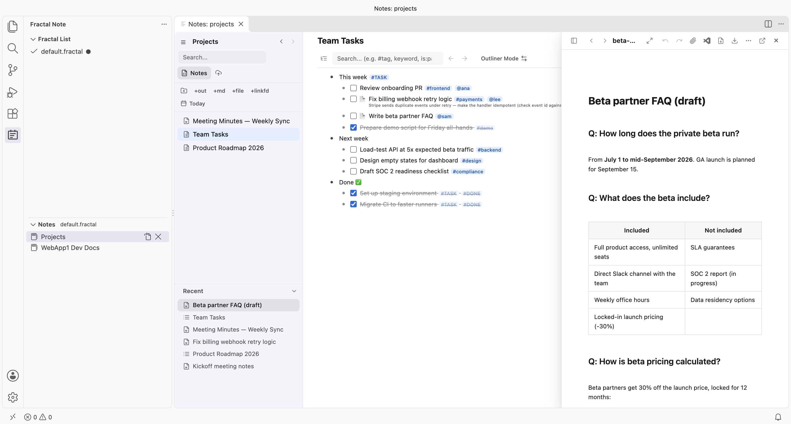
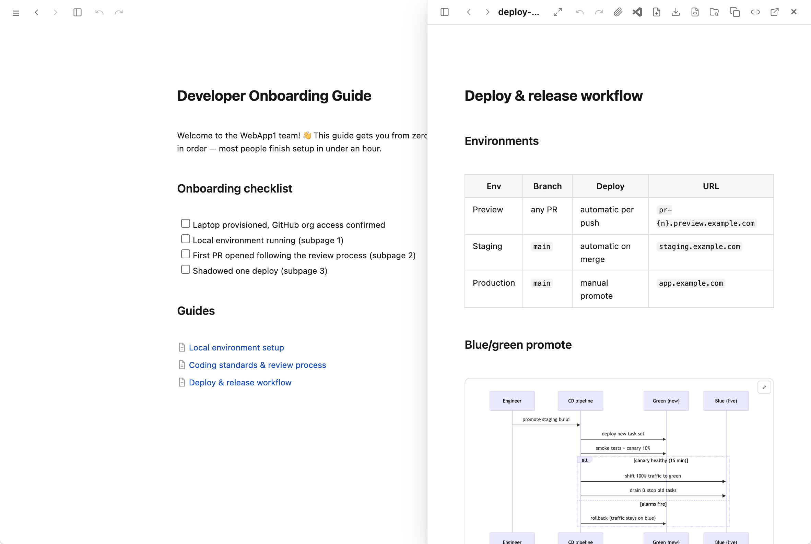
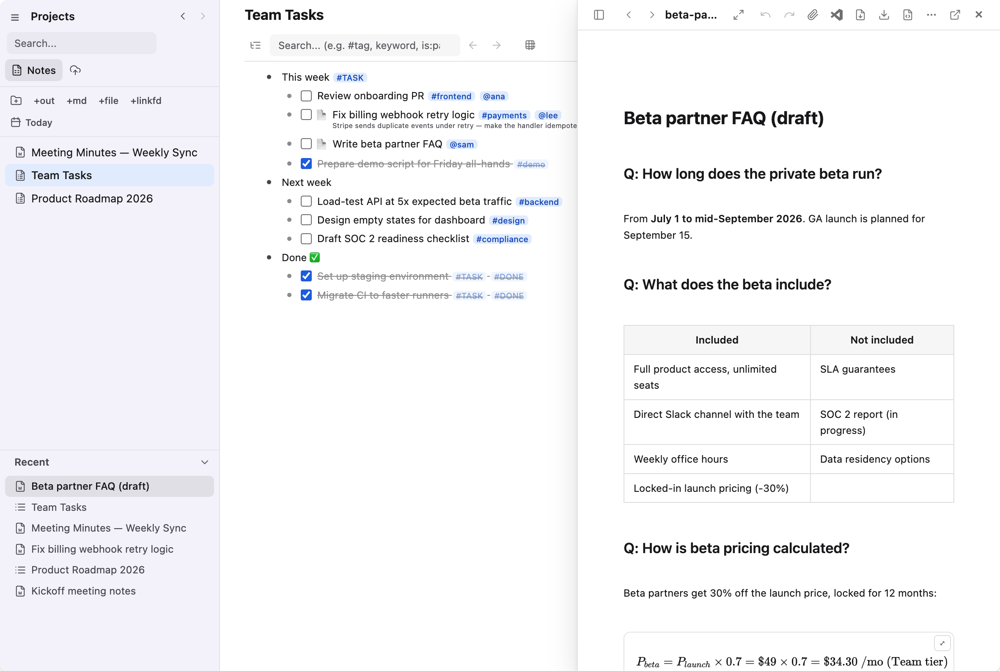
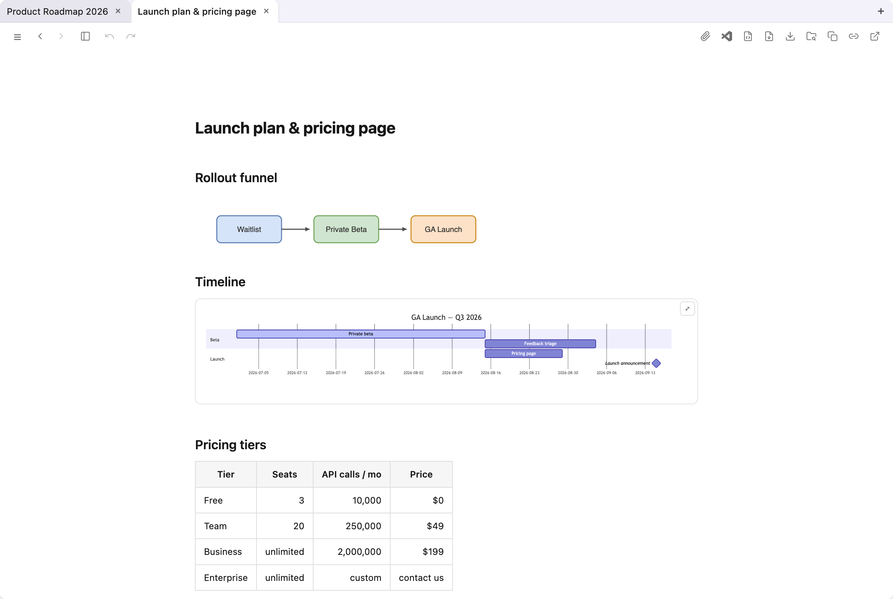
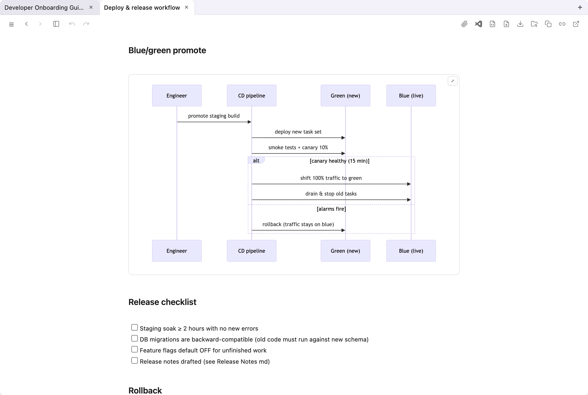
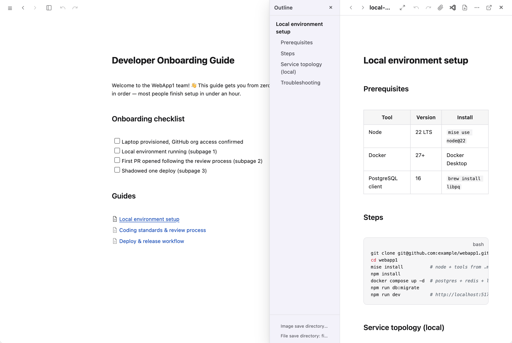
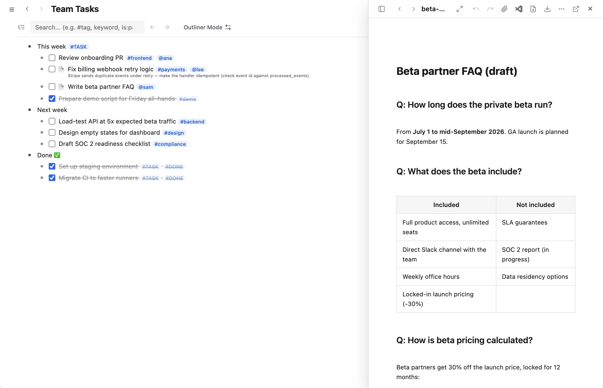
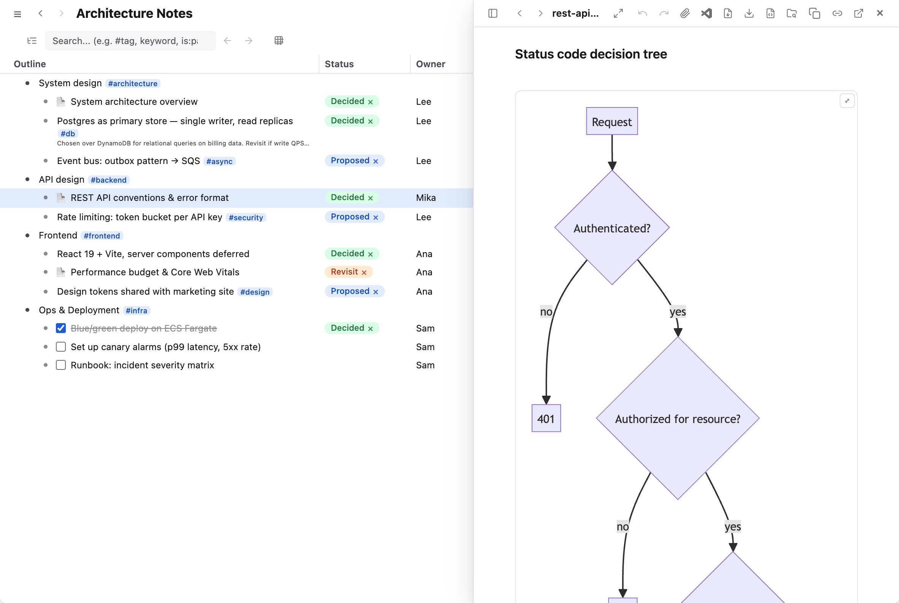
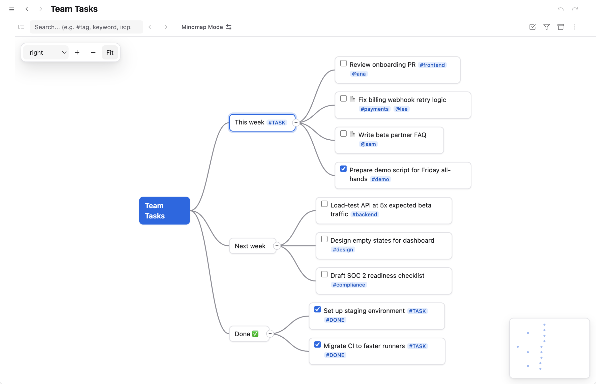
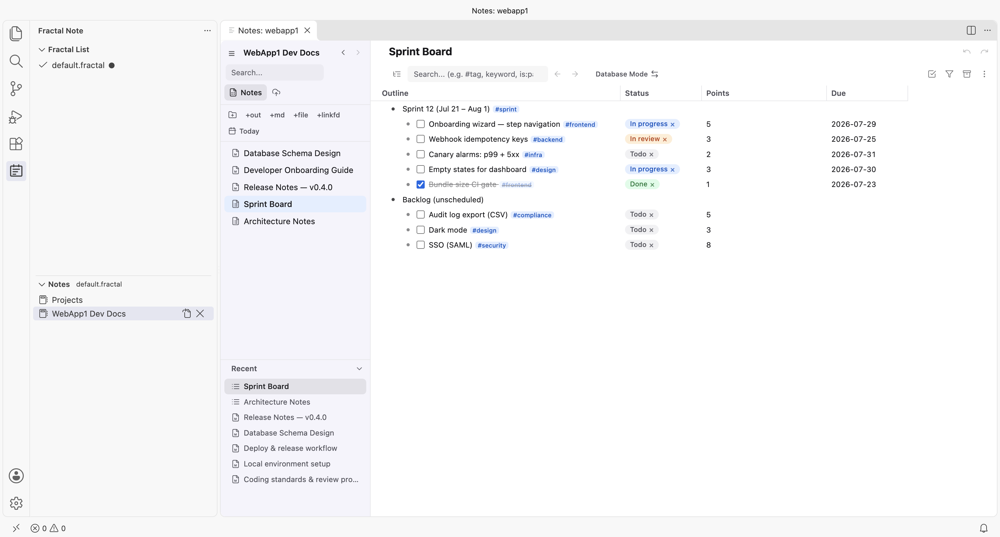

 Fractal Note — Markdown, Outliner, Database, Mindmap — and all your files, in one place
=

> **Designed to feel like Notion — and to stay fully local and fast, like Obsidian.**

**A complete note-taking environment inside VS Code.** Fractal Note combines a **Notion-like WYSIWYG markdown editor** and a **Dynalist-like outliner (with Database / Mindmap modes)** in a single workspace. And **your notes and your documents live in one place** — keep any file (PDF, Word, Excel, PowerPoint, …) in the file tree, or **embed it directly into a markdown document or an outline node**, and **search its contents full-text** along with everything else. If your files have outgrown your folders — scattered across directories, always separated from the notes that reference them — **this is built for exactly that problem**. Organize it all into **Notes**, sync it to S3 — and it's built from the ground up for **working alongside AI coding assistants**.


🌐 **Website: [raggbal.github.io/fractal](https://raggbal.github.io/fractal/)** — also available as a **desktop app for macOS** (no VS Code needed).

📦 **Install:** [Desktop app (macOS)](#desktop-app-macos) · [VS Code extension](#vs-code-extension) · [AI agent plugin](#ai-agent-plugin) · [Web clipper (Chrome)](#web-clipper-chrome-extension)

---

## Why Fractal Note

- ✍️ **WYSIWYG Markdown** — Edit and read at the same time. No split preview, no raw markup. Tables (Excel-like editing, **cell merging included**), code blocks, Mermaid, math, draw.io — all rendered live.
- 🌲 **A real outliner** — Dynalist / Workflowy-style tree editing, with tag management, smooth filtering, and three modes: **Outliner / Database / Mindmap**.
- 📄 **Subpages** — Embed markdown pages as children of outline nodes or of other markdown pages. Build hierarchical documents like a Notion database.
- 🤖 **AI-friendly by design** — External file changes are reflected on screen **in real time**. Let Claude Code, Cursor, or Kiro edit your notes while you keep working — your cursor position and in-progress edits are preserved.
- 🗂 **Notes** — Organize by folder ("note"). Files stay flat on disk while a virtual folder/file tree keeps everything structured on screen — including **arbitrary file attachments** (PDF, Excel, …). Cross-file full-text search — **including inside attached PDF / Word / Excel / PowerPoint files and any text-based attachment (HTML, JSON, …)**, with page / slide / sheet-cell hit locations and backlinks to the referencing nodes — tabs and history, Daily Notes.
- ☁️ **S3 backup & restore** — One-click backup to your own AWS S3 bucket, and restore from it.
- 🧩 **Beyond the editor** — A Chrome extension for clipping web pages, Amazon Translate integration, and published **AI skills** that let AI agents read and write your notes in Fractal Note (use Fractal Note instead of Obsidian).

`.md` and `.out` files work standalone, but Fractal Note shines when everything is connected in the **Notes manager**.

---

## 📦 Installation

Pick what you need — they all work on the same notes:

| | What it is | Where |
| --- | --- | --- |
| 🖥 [Desktop app (macOS)](#desktop-app-macos) | Fractal Note as a standalone app, no VS Code needed | [Apple Silicon `.dmg`](https://github.com/raggbal/fractal/releases/latest/download/Fractal-mac-arm64.dmg) · [Intel `.dmg`](https://github.com/raggbal/fractal/releases/latest/download/Fractal-mac-x64.dmg) |
| 🧩 [VS Code extension](#vs-code-extension) | Fractal Note inside VS Code and compatible editors | [VS Code Marketplace](https://marketplace.visualstudio.com/items?itemName=imaken.fractal) · [Open VSX](https://open-vsx.org/extension/imaken/fractal) |
| 🤖 [AI agent plugin](#ai-agent-plugin) | Lets Claude Code, Codex and Kiro search, read and edit your notes | this repository (`agent-capability/install.sh`) |
| 🌐 [Web clipper](#web-clipper-chrome-extension) | Saves web pages into a note from Chrome or Edge | this repository (`chrome-extension/`) |

The same steps, with screenshots of the app, are on [the website](https://raggbal.github.io/fractal/).

### Desktop app (macOS)
Fractal Note as a standalone app — no VS Code needed. It runs the very same code as the VS Code extension, so your notes look and work the same in both.

- Apple Silicon (M1 or later) or Intel Mac, macOS 13 Ventura or later
- Not yet for Windows or Linux

1. **Download and open the dmg** — Download [`Fractal-mac-arm64.dmg`](https://github.com/raggbal/fractal/releases/latest/download/Fractal-mac-arm64.dmg) for Apple Silicon or [`Fractal-mac-x64.dmg`](https://github.com/raggbal/fractal/releases/latest/download/Fractal-mac-x64.dmg) for an Intel Mac, and double-click it. (Not sure? Apple menu → About This Mac: “Chip: Apple M…” is Apple Silicon, “Processor: Intel…” is Intel.)
2. **Drag it to Applications** — In the window that opens, drag `Fractal.app` onto the Applications folder.
3. **Open Fractal** — Open Fractal from Applications. The app is signed with an Apple Developer ID and notarized by Apple, so macOS only asks once whether to open an app downloaded from the internet — click **Open**.
4. **Start writing** — Fractal opens your notes list, `~/.fractal/default.fractal` — the same list the VS Code extension uses on this Mac. Add a folder as a note from the sidebar.

- **Update** — Quit Fractal, download the new dmg and replace `Fractal.app` in Applications. There are no automatic updates yet — see [Releases](https://github.com/raggbal/fractal/releases).
- **Settings** — **Fractal → Settings…** (⌘,) opens the settings screen: the same `fractal.*` settings as in VS Code, applied as you change them. They are saved in the app's own `settings.json` (**Help → Open Settings File**); VS Code's settings are not read.
- **Not in the desktop app yet** — S3 sync and translation, opening draw.io diagrams in an external editor, automatic updates.
- **Uninstall** — Delete `Fractal.app`. The app's own data is in `~/Library/Application Support/Fractal`. Your notes are never touched.

### VS Code extension
The same Fractal Note inside VS Code and VS Code–compatible editors — on macOS, Windows and Linux (tested day to day on macOS).

- **VS Code Marketplace** (Visual Studio Code) — Open the Extensions view (`Cmd+Shift+X` / `Ctrl+Shift+X`), search for **“Fractal Note”** and click **Install**. Or [open it in the Marketplace](https://marketplace.visualstudio.com/items?itemName=imaken.fractal), or run:
  ```bash
  code --install-extension imaken.fractal
  ```
- **Open VSX** (VSCodium, Cursor, Kiro, Gitpod, Eclipse Theia and other editors that use the Open VSX Registry) — search for “Fractal Note” in the editor's extensions view, or [open it in Open VSX](https://open-vsx.org/extension/imaken/fractal).
- **From a VSIX** — Download `fractal-<version>.vsix` from [Releases](https://github.com/raggbal/fractal/releases/latest), then:
  ```bash
  code --install-extension fractal-<version>.vsix
  ```
- **From source**
  ```bash
  git clone https://github.com/raggbal/fractal
  cd fractal
  npm install
  npm run compile
  # press F5 to launch in debug mode
  ```

### AI agent plugin
An MCP server and a skill that let **Claude Code, Codex and Kiro** search, read and edit your notes — outlines, markdown pages, attachments — with the same code as the app, so the result is the same as doing it on screen ([🤖 AI skills](#-ai-skills--make-fractal-note-your-agents-notebook)).

- Node.js 18 or later, git
- Built from this repository

1. **Get the repository**
   ```bash
   git clone https://github.com/raggbal/fractal && cd fractal && npm install
   ```
2. **Install the plugin** — Builds the plugin and installs it into every agent it finds: Claude Code and Codex as a plugin, Kiro as a Power. For Antigravity it prints the command to set by hand.
   ```bash
   agent-capability/install.sh
   ```
   Only some agents: `--only claude,codex,kiro`. See what it would do: `--dry-run`.
3. **Start a new session** — The tools (`fractal_search`, `fractal_get`, `fractal_add`, …) appear in a new session (Claude Code: or `/reload-plugins`). Ask, for example, “Summarize this week's meeting notes in Fractal”.

- **Install by hand** — After `npm install` and `npm run build:mcp` in the repository:
  - Claude Code: `/plugin marketplace add <repo>/agent-capability` → `/plugin install fractal@fractal-local`
  - Codex: `codex plugin marketplace add <repo>/agent-capability` → `codex plugin add fractal@fractal-local`
  - Kiro: `kiro-cli powers install <repo>/agent-capability/plugin` (or Powers → Add Custom Power → Import power from a folder)
- **Update** after `git pull`: `agent-capability/install.sh --update`
- **Remove**: `agent-capability/install.sh --uninstall`. Details: [agent-capability/README.md](agent-capability/README.md)

### Web clipper (Chrome extension)
Saves any web page into a note — straight from Chrome or Edge, without VS Code ([🌐 Chrome extension](#-chrome-extension-web-clipper)).

- Chrome or Edge (or another Chromium-based browser)
- Your notes list (`.fractal`) from the desktop app or the VS Code extension
- Not in the Chrome Web Store yet — you load it from this repository

1. **Get the repository** — No build needed.
   ```bash
   git clone https://github.com/raggbal/fractal
   ```
   Without git: **Code → Download ZIP** on GitHub, and unzip it.
2. **Load it into Chrome** — Open `chrome://extensions`, turn on **Developer mode** (top right), click **Load unpacked** and choose the `chrome-extension` folder of the repository. Its Settings open by themselves the first time (later: right-click the clipper's icon → **Options**). The language is at the top right.
3. **Choose your `.fractal`** — Click **📄 Choose .fractal…** and choose the notes list Fractal uses, `~/.fractal/default.fractal` by default. `~/.fractal` is a hidden folder: on a Mac, press **⌘⇧G** in the dialog and type `~/.fractal`. The clipper reads your notes from it every time, so notes you add in Fractal show up by themselves.
4. **Enable your notes** — Chrome lets an extension write only into folders you choose yourself, so a yellow box in Settings lists the folders to choose (for example `~/workspace/fractal`). Click **Choose…** next to one: it copies the path and opens the folder dialog, which opens wherever it was last. Press **⌘⇧G**, paste with **⌘V**, press Enter, click **Select**, and let Chrome edit files. Every note inside that folder shows **✓ Ready**. Notes of another computer in the `.fractal` (such as `/home/ec2-user/…` on a Mac) say so and are left out. Click ☆ on a note to show it first in the popup.
5. **Clip** — On any page, click the clipper's icon, pick the note and where in it (an outliner or a markdown page), and click **📌 Bookmark**. **`Alt+Shift+F`** saves to the place you saved to last, without opening the popup.

- **If Chrome forgets the permission** (for example after a restart) — the yellow box shows **Allow again** for that folder. One click brings all its notes back.
- **Update** — `git pull` (or a new zip), then click **↻** on Fractal Web Clipper in `chrome://extensions`. Your settings stay.
- **Uninstall** — Click **Remove** in `chrome://extensions`. Your notes are never touched.
- Details (in Japanese): [chrome-extension/README.md](chrome-extension/README.md)

### Optional: AWS credentials (S3 sync & translation)
Core features work without AWS. S3 sync and Amazon Translate use one set of AWS settings:

- **If the AWS CLI works on your computer, set nothing.** Fractal uses the same credentials as the CLI — environment variables, the `default` profile in `~/.aws` (or `AWS_PROFILE`), SSO (`aws sso login`), and so on. The AWS CLI itself is not needed: the built-in AWS SDK reads the same files.
- **Otherwise, set an access key:** `fractal.awsAccessKeyId` and `fractal.awsSecretAccessKey`.
- **Region:** `fractal.awsRegion` (e.g. `ap-northeast-1`). Empty = the region of your AWS CLI profile, else `us-east-1`. S3 sync follows the bucket's region by itself.

The old separate settings (`fractal.s3AccessKeyId` …, `fractal.transAccessKeyId` …) are moved to these automatically. Note: connections through an HTTP(S) proxy are not currently supported for these features.

---

## Key visuals

### In VS Code
Fractal Note lives in the activity bar: pick a notes list and a note on the left, and the note opens in an editor tab — the note tree, an outline, and a page in the side panel.


### Markdown editor
A markdown editor with the same pleasant writing feel as Notion. Every basic markdown element is available, plus extended features like code blocks, math blocks, Mermaid blocks, embedded draw.io diagrams, and text color — covering everyone's markdown needs.
It also supports Notion-style **subpages** (distinct from plain links), so you can manage markdown hierarchically.


### Outliner editor
A Dynalist-class outliner. Folders, tags, and full-text search across both outline node text and markdown bodies.
The same outline can also be switched into **Database mode** (a Notion-like table) and **Mindmap mode** (an editable SVG mindmap).


---

## ✨ Core concept

**Manage Markdown, Outliner, Database, and Mindmap in one place — like Notion.** In Fractal Note these four kinds of content aren't separate tools; they connect inside the same note — hang markdown pages off outline nodes, view the same outline as a database or a mindmap, and search across all of it. And your data stays plain `.md` files and JSON.

| Content | Storage | Summary |
| --- | --- | --- |
| **Markdown** | `.md` | Notion-like WYSIWYG editor. Edit and read in a single view. Hierarchy via subpages |
| **Outliner** | `.out` | Dynalist-like tree editing. Tags, tasks, search |
| **Database** | `.out` (view) | The same outline as a Notion-like table. Text / tag / date columns |
| **Mindmap** | `.out` (view) | The same outline rendered and edited as an SVG mindmap |

Tying it all together is **Notes** — a folder-scoped workspace (virtual tree, cross-file search, tabs, Daily Notes, S3 sync). Markdown pages open from both the markdown editor and the outliner. Subpages open in the **side panel** by default, or as standalone documents in a **new tab**.

**Every file lives in one place, and moves freely.** Not just `.md` and `.out` — attach any file (PDF, Excel, images, …) to a note, and move it between the **note tree, outliner nodes, and markdown documents** with simple drag & drop or copy/cut/paste shortcuts. Ownership follows the move automatically, links keep working, and cross-note moves copy the assets for you — no manual file wrangling.

---

## 📝 Markdown editor (.md)
A Notion-style WYSIWYG editor. What you see is exactly what's in the file.



### Editing
- **Seamless live preview** — Markdown renders the moment you type it. Switch to **source mode** anytime (`Cmd+.`)
- **Headings, lists, task lists, quotes, horizontal rules** — all standard markdown, keyboard-first
- **Tables** — Excel-like cell selection: click selects a cell, arrows move, Shift+arrows / drag / Shift+click select ranges, and cmd+c/x/v interoperate with spreadsheets (TSV + HTML both ways). Enter/typing edits a cell; Tab moves right (last cell appends a row). Merge/unmerge cells from the toolbar (persisted as GFM-compatible markdown with a marker comment), filter rows with the toolbar search box (display-only), resize columns by dragging cell edges, and toggle the header row on/off — all markdown stays compatible with other viewers
- **Blocks inside list items** — Quote and code blocks can live inside a list item's continuation lines (Shift+Enter), created via `> ` / ` ` ``` autoformat, the palette, or shortcuts, and they survive markdown round-trips
- **Code blocks** — Syntax highlighting for 24+ languages, expandable into a VS Code editor tab
- **Inline formatting** — Bold, italic, strikethrough, inline code, smart link creation
- **Action palette** (`Cmd+/`) — Every formatting and insert action in one searchable menu

### Attachments & media
- **Images** — Paste or drag & drop. Full-screen lightbox with pinch-zoom and pan. Max display width is configurable
- **File attachments** — Drop any file (PDF, Excel, …) to insert a `[📎 filename](path)` link. Click to open — Office files (Word / Excel / PowerPoint), PDF, HTML, images and text/code files in the built-in viewer, everything else in the OS default app. Links show a file-type icon (📕 pdf / 📘 doc / 📗 xls / 📙 ppt / 🌐 html). The link text is editable like any other link; copy/cut a fully selected link text and it travels *as a link*, and dragging the 📎 icon moves the link within the document or out to the notes tree
- **Attachments panel** — Lists every image and file referenced in the document, with Open / Copy Path

### PDF export
- **One click to PDF** — Toolbar / side-panel button (or `Fractal Note: Export to PDF`) turns the current markdown into a print-ready PDF, rendered exactly like the editor (Mermaid, math, colors, checkboxes included)
- **Smart page breaks** — Breaks before `h1`/`h2` by default, but not before the first `h1` or the first `h2` right after an `h1` — chapters flow naturally
- **Your own stylesheet** — `fractal.pdfStyles` (array of CSS file paths) is applied after the built-in print style, so your rules win. Page breaks are plain CSS (`break-before`), so you can disable or extend them freely
- **Local & dependency-free** — Uses your installed Chrome/Edge headlessly; no network access during export, nothing added to the extension bundle

### Export bundle — take a document out of the note
Notes keep files flat with note-relative links, so copying a single `.md` out by hand breaks its images and subpages. **Export bundle** packs everything into one portable folder:
- Right-click an outliner node (or use the side-panel button on a markdown page) → **Export bundle**
- The page plus its **subpages (recursive), linked pages, images, and attachments** are copied into a single folder, with all links rewritten to be self-contained — ready to share, publish, or drop into another tool

### Diagrams & math
- **Mermaid** — Rendered inline; click to edit the source
- **KaTeX math** — Display-mode formulas re-render live; both ```` ```math ```` blocks and `$$...$$` blocks (Typora/Obsidian compatible), CJK/Hangul-friendly rendering

### Embedded draw.io

Create and edit draw.io diagrams without leaving VS Code.

- **Create** — `Cmd+/` → **Insert Drawio Diagram** generates an empty diagram and inserts it as an image at the cursor. Dragging & dropping existing `.drawio.svg` / `.drawio.png` files also works
- **File format** — Diagrams are saved as `.drawio.svg` (a real SVG with draw.io's editing data embedded inside). They render as images on GitHub as-is and stay editable in any draw.io client. They're embedded in the document as ordinary `` images, so compatibility with other markdown editors is preserved
- **Edit** — Hover a diagram to reveal three buttons:
  - **Open in VS Code** — Open it in a VS Code tab. With the [Draw.io Integration extension](https://marketplace.visualstudio.com/items?itemName=hediet.vscode-drawio) (hediet.vscode-drawio) installed, the draw.io editor opens right inside that tab (recommended)
  - **Open in External** — Open it in an external app. draw.io Desktop is preferred if installed; otherwise the OS default app is used
  - **Copy Path** — Copy the absolute path to the clipboard
- **Automatic re-render** — However you edited it, the diagram in your open document redraws itself the instant you save. A seamless edit loop — just bounce between editors

### Subpages
Embed markdown pages inside markdown pages, like Notion. A subpage isn't a mere link — it's **owned by its parent**, and that ownership follows the parent everywhere:

- `Cmd+/`** → Add Page** (or `Cmd+N`) — Create a child markdown page and insert a link at the cursor
- Click a `.md` link to open it in a **Notion-style side-peek panel** with full WYSIWYG editing, including back/forward navigation (`Opt+←` / `Opt+→`)
- `Cmd+Shift+click` (Windows / Linux: `Ctrl+Shift+click`) to open it in a **new tab** — the same modifier works on note-tree rows (anywhere on the row) and on the outliner's 📄 / 📎 icons, or use **Open in new tab** from the right-click menu
- Pages within pages — build hierarchies as deep as you like
- **Subpages travel with their parent** — copy a parent (node copy/paste, cross-note paste, "Move to Other Note") and its subpages are duplicated or moved along with it, images and attachments included, with links rewritten so nothing breaks. Delete the parent and orphaned subpages are collected by Clean Unused Files

### AI-friendly: live sync of external changes
When an AI assistant (Claude Code, Cursor, Kiro, …) — or anything else — modifies the file you have open:

- **Block-level DOM diffing** — only the changed blocks are patched; your cursor position and in-progress edits survive
- Your edits and the AI's edits **coexist safely** in the same document
- `Cmd+L` — send the selected text to the AI chat. `Cmd+Shift+.` opens the file in the VS Code text editor

### Standalone mode
- Set Fractal Note as your **default editor for **`.md` and edit any markdown on your machine — no note workspace required
- For standalone files you can **choose where images and attachments are saved** (stored in a hidden `.fractal.json` file next to the markdown — the markdown body itself is never touched, so other editors never see it)

---

## 🌲 Outliner (.out)
A Dynalist-like outliner. The same data from three perspectives.

#### Outliner mode


#### Database mode


#### Mindmap mode


### Three modes
The tag next to the search box shows the current mode (for example **Database Mode ⇄**); click it to switch to the next one:

1. **Outliner mode** — Classic bullet tree. Unlimited nesting, collapse/expand, subtree scoping with breadcrumbs
2. **Database mode** — Your outline as a Notion-like database (tree table). Text and tag (multi-select) columns, plus optional **Date / Date & Time columns** with a native date picker
3. **Mindmap mode** — The same `.out` rendered as an SVG mindmap. Four layouts (radial / left / right / balanced), keyboard-centric editing (navigation, sibling/child insert, swap, type-to-edit, copy/cut/paste with descendants), node colors and shapes, boundaries (groups), relationship lines — plus image attach/delete and drag & drop of 📄/📎 nodes to and from the note tree and markdown editors

### Organize with tags & search
- `#tag` and `@tag` are auto-highlighted; click to filter instantly
- **Pinned tags** — Turn frequent tags into one-click filters
- **Dynalist-compatible search** — AND, OR, NOT, `"phrases"`, `#tag`, `in:title`, `has:children`, `is:page`, `is:task` — with smooth incremental filtering

### Attach anything
- **Markdown subpages** — Turn any bullet into a page (`@page`) and edit it in the side panel's full WYSIWYG editor. Manage hierarchical markdown like a **Notion database**
- **Images** — Paste with `Cmd+V`. Thumbnails appear under the node; drag to reorder, double-click to zoom
- **Files** — Attach any file type to a node. 📎 nodes open Office / PDF / HTML / images / text in the built-in viewer, everything else in the OS default app
- `.md`** import** — Import Notion / Obsidian exports as page nodes. Images are copied automatically and paths rewritten
- **Import a whole folder** — Pick any folder and its contents come in as a node hierarchy: subfolders become nodes, `.md` files become page nodes, everything else becomes 📎 attachments. The files are **copied into the note** (not referenced), so the outline is self-contained. Hidden entries and symlinks are skipped
- **Export a folder** — The mirror image: write any subtree back out as **real folders and files**. Nodes with children become folders, leaf nodes become `<node text>.md` or their attachment, and a node's own attachments land directly in its folder. Existing files at the destination are never overwritten (a counter is appended instead)
- **Right-click a node** for the Import / Export folder actions as well as the ≡ header menu — the right-clicked node is the target

### Tasks
- `- [ ]` / `- [x]` checkboxes with rich keyboard support (`Cmd+Shift+X` to toggle)
- **Task mode** — New root nodes automatically get checkboxes
- **Task filter** — Hide completed subtrees with one click
- **Archive to Daily Notes** — Move finished tasks (with their pages, images, and files) under today's Daily Note, tagged `#TASK #DONE`

### Editing basics
Enter / Tab / Shift+Tab work the way you expect. Multi-select indenting, node moves (`Cmd+Shift+↑/↓`), subtext (`Shift+Cmd+Enter`), inline formatting, clickable links, navigation history (`Opt+←/→`), and full undo/redo. See "Key shortcuts" below for details.

---

## 🗂 Notes — where everything connects

Fractal Note organizes information into **notes**. Just register any folder from the activity bar.


- **Structure without lock-in** — Files are stored **flat** on disk while you organize `.out`, `.md`, and **any other files** in a **virtual folder/file tree** with drag & drop. Your data stays plain files
- **Import anything** — drag a .md from Finder **or the VS Code Explorer** (hold Shift for Explorer drops) onto the file tree to copy & register it into the note; drop **any file** (PDF, Excel, zip, …) to store it in the note's shared `files/` folder — click to open (Office / PDF / HTML / images / text in the built-in viewer, anything else in the OS default app; on a remote VS Code server this becomes a browser download)
- **Files flow everywhere** — drag a tree file, an outliner 📎/page node, or a markdown 📎/subpage link onto any outliner or markdown editor (main pane, side panel, or tree item) — or back into the tree. Grab an outliner **node's bullet** and that node's own attachments (md page / 📎 files) travel with it — no need to aim at the small icons; a node's descendants' attachments stay where they are. Within a note the physical file never moves (only its owner changes); across notes the file is copied to the destination and the source copy is kept until Clean Notes collects it
- **Markdown moves carry their assets** — when a markdown file travels across notes, between the tree and a linked folder, or between folders inside a folder view (drag & drop or Duplicate), its images, 📎 attachments, and subpage markdowns (recursively) are copied along with it, and the layout converts automatically: a note's flat shared `images/` / `files/` ⇄ `images/` / `files/` folders next to the md in a linked folder. **Safety rule**: only files inside the source's own territory are followed — a note's asset folders, or anywhere inside the linked folder for moves out of a folder link. References that escape it (absolute paths or `../` beyond the boundary) are never copied; the link text is left untouched. This stops a crafted markdown from smuggling arbitrary local files (SSH keys, password files, …) into a note, where they would otherwise ride the S3 sync. Plain clipboard copy & paste of markdown text is unaffected
- **The outliner has two clear modes** — **node edit mode** is the default (you have a caret and typing goes into the node); selecting nodes puts you in **selection mode**, where the **caret disappears** and printable keys do nothing instead of damaging the node. Selection mode is entered with `Cmd/Ctrl+click`, `Shift+click`, `Shift+↑↓` or the second `Cmd+A`, and left with `Esc`, a bare `↑` / `↓`, or a plain click. Selected nodes are **amber** while a text range stays blue, so the two `Cmd+A` stages are told apart by hue (the file tree, folder views and mindmap keep their blue selection)
- **Copy & paste between the outliner and a linked folder** — `Cmd+C` in a folder view then `Cmd+V` on an outliner node **duplicates** those files as siblings right after the node (a multi-selection is reproduced). `Cmd+C` on outliner nodes then `Cmd+V` in a folder view duplicates them there: onto a folder row puts them **inside** it, onto a file row puts them **at the same level**, onto empty space puts them at the root. `Cmd+C` → `Cmd+V` **within** a folder view duplicates in place. Dragging still **moves**; the clipboard always **duplicates**. Pasting rich text copied from another application never triggers this — the source is verified against what you actually copied (or the file you have open) before anything is read from disk
- **Link local folders** — register any folder on disk as a 🔗 **folder link** (`+linkfd`) and browse it in a built-in **folder view**: filter by name, create / rename / duplicate / delete (delete always via the OS trash), open markdown in the side panel and viewer-supported files (Office / PDF / HTML / images / text) in the built-in viewer — a single click on a file's 📄/📎 icon opens it too. The view **live-reloads** when files change on disk (builds, AI edits, …), and a 👁 header toggle shows hidden dotfiles when you need them (persisted per folder link; note that this can reveal sensitive folders like `.git` or `.ssh`). Drag files between the folder view and the **file tree** and the drop **duplicates** — the original stays exactly where it was, including a markdown's accompanying images / attachments / subpages. Drops between the folder view and **side-panel markdown** still **move** the file, so it lives in exactly one place — when a markdown moves out that way, its accompanied images / attachments / subpages are cleaned up from the linked folder too (only when every copy succeeded, and never while another markdown in the folder still references them). Where the OS trash is unavailable (e.g. on a remote VS Code server) the verified-copied original is removed directly. The linked folder itself stays a plain reference: it's never synced, cleaned, or touched outside your explicit actions
- **Select many rows at once** — in the file tree and in a folder view, `Shift+click` selects a contiguous range (a folder view also takes `Shift+↑↓`) and `Cmd/Ctrl+click` toggles single rows (`Esc` clears). Drag the whole selection anywhere a single row goes: into a folder view, an outliner, a markdown editor, or another place in the tree — mixed kinds travel together in one batch, and anything that fails is reported per item with a single summary. **Reordering nodes inside an outliner moves the whole selection too** (keeping its order; one `Cmd+Z` undoes the lot). **Inside a folder view, dragging a multi-selection now moves every selected file in one go** — if any one of them cannot be moved the whole drop is refused rather than half-applied, and you get a single summary instead of one toast per file. In the outliner, **`Cmd+A` escalates in two steps**: the first press selects the text of the node you are in, pressing it again selects every node (an empty node skips straight to selecting all). Mindmap mode still selects every node in one press
- **Walk the file tree from the keyboard** — click a row, then `↑↓` to move. **The content pane does not change while you move**; only `Enter` opens (on a virtual folder row `Enter` expands / collapses). Focus stays in the tree afterwards, so `↓ Enter ↓ Enter` walks through your files
- **Open in a new tab** — `Cmd+Shift+click` (Windows / Linux: `Ctrl+Shift+click`) works the same on file-tree rows, the outliner's 📄 / 📎 icons and links in the markdown body, and the right-click menu offers it too (an outliner node lists the md page and the 📎 file as separate entries). Formats the viewer cannot render, and files over 50MB, open in the OS default app instead
- **Send to the other side** — right-click in a folder view → **Send to Outliner** imports the selection at the top of the outliner root; right-click an outliner node → **Send to linkedfd** writes the selected nodes out as a real folder tree into one of your registered folder links (picked from a submenu). Dropping a folder onto an outliner editor imports it the same way as *Import folder*
- **Full-text search** — Search across every outline, subpage, and standalone markdown file in the note — **and inside attached PDF / Word / Excel / PowerPoint files, plus any text-based attachment (HTML, JSON, CSV, source code, …)** — with page / slide / sheet-cell hit locations and backlinks to the referencing nodes. Streaming results, click to jump
- **Filter by file type** — start the query with `ext:` to narrow the search: `ext:pdf invoice` searches only PDFs, `ext:pdf,docx report` covers both, `ext:md` / `ext:out` limit to markdown or outlines. Case and a leading dot don't matter (`ext:PDF` = `ext:.pdf`); put `ext:` anywhere else in the query and it's treated as literal text. The same syntax works in the `fractal-search` CLI (combines with `--scope`)
- **Tabs** — Switch between outliners and markdown files inside a note with browser-like tabs. Tab names follow the title / H1, and you can right-click an md tab to open it as a VS Code tab as well
- **Recent** — Jump back to a recently opened file with one click — markdowns and outlines, plus linked folders (🔗) and viewer/attachment files (📎)
- **Daily Notes** — One-click daily journal. Auto-creates a year/month/day hierarchy, with `<` `>` navigation and a calendar picker
- **In-app links** — Copy a link to any node or page (right-click a node / tree item → **Copy In-App Link**, or 🔗 in the side-panel header) and paste it anywhere in Fractal Note. Click to jump
- **Cross-note copy & paste with assets** — Copy markdown containing images, 📎 attachments, or subpage links and paste it into another note (md or outliner): the linked files are duplicated into the destination note and links keep working. Pasting into an outliner turns whole-line links into proper attachment / image / page nodes
- **Housekeeping** — "Clean Unused Files" finds orphaned images, pages, and attachments and moves them to the trash. "Move to Other Note" relocates pages together with their assets

### 📄 Built-in file viewer (Office, PDF, HTML, images & text)
Click an attached file anywhere — in the file tree, on an outliner 📎 node, or from a markdown 📎 link — and it opens right inside Fractal Note:
- **Word / Excel / PowerPoint** — read `.docx` / `.xlsx` / `.pptx` without leaving the editor, with **zero external dependencies**. Word renders page-width cards with tables, lists, images and ruby; Excel is a real spreadsheet grid (formats, colors, merged cells, sheet tabs, comments, hyperlinks — smooth even at 100k rows); PowerPoint shows slides with shapes, theme colors, auto-fit text, real list numbering and vertical Japanese text — vector EMF images (the format Office uses for logos) render as crisp SVG in both Word and PowerPoint
- **Plus PDF, HTML, images and text/code** — PDFs render locally with smooth selection (works on older-Chromium VS Code forks too); HTML is static by default (scripts only after explicit opt-in); images pan & zoom (incl. safe SVG display); 30+ text/code formats (.txt/.json/.js/.py/…) open read-only with line numbers
- **Zoom & pan everywhere** — trackpad pinch (Ctrl/Cmd+scroll) zooms the content at the cursor in every viewer — without zooming the whole VS Code window — with [−][+] and a ⟲ reset button on all kinds (PDF's reset also re-enables width auto-fit). HTML zooms like the browser's own Cmd± (pages re-flow to fill the pane), and zoomed PDFs pan by dragging (text selection still works; middle-button drag always pans)
- **Three surfaces** — the note's main pane (as a regular tab), the side panel next to what you're writing, or a standalone VS Code tab
- **Find inside any file** — Cmd/Ctrl+F (or 🔍): highlights, match count, next/previous. Clicking a full-text-search hit opens the file pre-filled and jumps to the hit — PDFs land on the right page, Excel jumps to the exact sheet & cell, PowerPoint to the slide
- **Same feel as the md editor** — the familiar icon toolbar (copy path / in-app link / export / open in OS app), and Esc closes the side panel with the cursor back exactly where you left off
- **Safe & fast** — instant display, everything renders locally; OOXML parsing is hardened against zip bombs and malformed files, and password-protected / oversized files degrade to a clear message

### ☁️ S3 backup & restore
With an AWS account, you can sync your notes to S3:

- **Whole-note sync (Tools tab)** — Bidirectional newer-wins sync of the entire note folder, or upload-all / download-all / clean rebuild
- Per-file, mtime-based newer-wins resolution: your local edits are never overwritten by older S3 content

### 🌍 Translation
Translate a selection or the whole document with **Amazon Translate**, including Custom Terminology support for better accuracy (`fractal.translateTerminology`: a CSV / TMX file — upload it with **Fractal: Update Translate Terminology** — or the name of a terminology already in Amazon Translate). The languages you pick last are remembered.

> S3 sync and translation use the AWS CLI's credentials on your computer, or an access key in settings — the AWS CLI itself is not needed. Everything else works without AWS.

---

## 🤖 AI skills — make Fractal Note your agent's notebook

Fractal Note ships everything AI agents need in [`agent-capability/`](agent-capability/README.md): an **MCP server** whose tools search, read, and edit notes / outliners / markdown with the same code as the extension, and a **skill** that teaches agents how to use them.

- **Tools**: `fractal_resolve` / `fractal_get` (identify and read notes, outliners, md) / `fractal_search` / `fractal_summary` / `fractal_add` / `fractal_modify` / `fractal_attach` / `fractal_tree` (nodes, pages, attachments, tree operations, moves) / `fractal_doctor` (integrity checks)
- **Claude Code** and **Codex** install it as a plugin; **Kiro** installs the same plugin folder as a Power

```bash
agent-capability/install.sh   # Claude Code / Codex: plugin / Kiro: Power
```

With the MCP registered, agents like Claude Code can organize research, summarize clips, and build knowledge bases by writing straight into Fractal Note — a practical **Obsidian alternative** with an AI-native workflow.

---

## 🌐 Chrome extension (web clipper)

Save any web page into a Fractal Note — straight from Chrome, without launching VS Code.

- Install: [Web clipper (Chrome extension)](#web-clipper-chrome-extension) — load `chrome-extension/` of this repository into Chrome or Edge
- Click the icon (or `Alt+Shift+F` for a quick clip) → the page is extracted with **Mozilla Readability** and converted through **Fractal Note's own HTML→MD pipeline** (tables, GFM, Medium / dev.to code blocks, and more)
- **Your notes come from your `.fractal`** — choose the `.fractal` Fractal uses (`~/.fractal/default.fractal` by default) and enable the folder that holds your notes once; notes you add in Fractal show up by themselves
- Save to an **outliner** (added as a page node) or to **markdown** (a new md is created and a subpage link is appended to the md you picked) — both are supported
- **★ notes come first** in the popup, each note starts on the place you saved to last in it, and `Alt+Shift+F` saves to the place you saved to last
- Writes directly to disk via the File System Access API — no communication with VS Code needed

See `chrome-extension/README.md` for details.

---

## 💻 Supported OS

| OS | Status |
| --- | --- |
| **macOS** | ✅ Verified (development and testing happen on macOS) |
| **Windows** | ⚠️ Implemented, not guaranteed |
| **Linux** | ⚠️ Implemented, not guaranteed |

The Windows / Linux implementations (path handling, clipboard, launching external apps, and so on) are in place, but day-to-day verification only happens on macOS, so **behavior cannot be guaranteed**. If you hit a problem, please file a request in [GitHub Issues](https://github.com/raggbal/fractal/issues) — I'll get to it when time allows. Reproduction steps plus your OS / VS Code version are much appreciated.

---

## 🚀 Getting started

### 1. Create your first note (recommended)
1. Click the **Fractal Note** icon in the activity bar (left edge of VS Code)
2. Click **+ Add Notes Folder** and pick (or create) an empty folder — say `~/notes/work`. That folder is now a **note**
3. Click the note name — the three-pane UI opens: **file tree (left) / editor (center) / outline & side panel (right)**

### 2. Add content to the note
Everything is created from the file tree on the left — right-click it (or a folder inside it):
- **New Outline here** — creates an outliner (`.out`). Start typing; Enter adds a node, Tab indents
- **New Markdown here** — creates a markdown page and opens it in the WYSIWYG editor
- **New Subfolder** — folders are virtual (the files on disk stay flat), so reorganize freely
- Or just **drag files in** — drop a `.md` from Finder / VS Code Explorer (hold Shift for Explorer) to import it; drop a PDF, Excel, or any other file to attach it

From an outliner, type `@page` at the end of a node (or press `Cmd+Enter`) to hang a markdown page off that node — this is the core Fractal Note workflow: **outline the structure, write the details in pages**.

### 3. Find it again
- `Cmd+P`-style cross-note search lives at the top of the file tree — press `Cmd+K` from anywhere in Notes to jump into it; results open in a **Results** tab. It matches node text, markdown bodies, and the contents of attached PDF / Word / Excel / PowerPoint files
- Click any `#tag` to filter; pin frequent tags for one-click filtering
- Tabs and navigation history (`Opt+←/→`) work like a browser

### Using the markdown editor standalone (without Notes)
Right-click any `.md` → **"Open with Fractal Note"**. To make it the default: right-click → **Open With…** → **Configure default editor** → **Fractal Note**

### Learning the ropes
- **`Cmd+Shift+/` (Ctrl+Shift+/ on Windows)** — toggles a shortcut overlay (HUD) for the current view (Markdown / Outliner / Mindmap / Database). Press again, hit Esc, or click anywhere to dismiss. This is the fastest way to discover features
- `Cmd+/` in the markdown editor opens the **action palette** — every formatting and insert action, searchable
- The full shortcut list is below

---

## ⌨️ Key shortcuts

A quick reference. (Mac notation; almost every shortcut also works with `Ctrl` instead of `Cmd`, and Windows/Linux uses `Ctrl`.)

### Markdown editor

| Shortcut | Action |
| --- | --- |
| `Cmd+/` | Action palette (searchable menu of every action) |
| `Cmd+N` | Add Page (create a subpage and insert a link) |
| `Cmd+.` | Toggle source mode |
| `Cmd+Shift+.` | Open in the VS Code text editor |
| `Cmd+\` | Toggle sidebar (outline / file panel) |
| `Cmd+L` | Send selected text to the AI chat |
| `Cmd+B` / `Cmd+I` / `Cmd+Shift+S` | Bold / italic / strikethrough |
| ``` Cmd+`  ``` | Inline code |
| `Cmd+1`…`Cmd+6` / `Cmd+0` | Heading 1–6 / back to paragraph |
| `Cmd+T` / `Cmd+Shift+I` | Insert table / insert image |
| `Cmd+F` / `Cmd+H` | Find / replace |
| `Cmd+K` | Notes only: focus the note search box at the top of the file tree (`Esc` returns to where you were) |
| `Cmd+S` / `Cmd+Z` / `Cmd+Shift+Z` | Save / undo / redo |
| `Tab` / `Shift+Tab` | Tables: move between cells (Tab on the last cell adds a row); lists: indent / outdent |
| `Shift+Enter` | Lists: line break within the item (continuation line) |
| `Opt+←` / `Opt+→` | Side-panel back / forward (side panel only) |

Tables have an Excel-like **select mode** (click a cell to enter it):

| Shortcut | Action |
| --- | --- |
| `↑↓←→` | Move between cells (up/down at the table edge leaves the table) |
| `Shift+↑↓←→` / `Shift+Click` / drag | Extend a rectangular range selection |
| `Cmd+C` / `Cmd+X` / `Cmd+V` | Copy / cut / paste the range — interoperates with Excel & Google Sheets (TSV + HTML, merged cells reproduced) |
| `Enter` / `F2` / type | Edit the cell (typing replaces the content) |
| `Enter` / `Tab` / `Esc` (while editing) | Commit and return to select / commit and move right / discard |
| `Delete` | Clear the contents of the selected range |

### Outliner mode

| Shortcut | Action |
| --- | --- |
| `Enter` / `Option+Enter` | New sibling node / new child node |
| `Shift+Enter` | Line break within the node text |
| `Shift+Cmd+Enter` | Open / close subtext (note) |
| `Tab` / `Shift+Tab` | Indent / outdent (multi-select supported) |
| `Cmd+Enter` | Open the page (creates one if missing; file attachments open in an external app) |
| `↑` / `↓`, `Shift+↑/↓` | Move between nodes / extend multi-selection |
| `Cmd+Shift+↑/↓` | Move node up / down |
| `←` / `→` | Collapse / expand (at start / end of line) |
| `Cmd+.` | Toggle collapse for the node |
| `Cmd+]` / `Cmd+Shift+]` | Scope in (zoom) / scope out |
| `Cmd+Shift+X` | Toggle checkbox (`Cmd+Shift+Opt+X` to remove) |
| `Cmd+B` / `Cmd+I` / `Cmd+E` / `Cmd+Shift+S` | Bold / italic / inline code / strikethrough |
| `Cmd+C` / `Cmd+X` / `Cmd+V` | Copy / cut / paste nodes (multi-select and image paste supported) |
| `Cmd+A` | 1st press: select the text of the current node / 2nd press: select every node (an empty node selects all nodes right away; Mindmap selects all in one press) |
| `Esc` | Leave selection mode (clears the node selection and puts the caret back) |
| `Cmd+F` / `Cmd+H` / `Cmd+Shift+F` | Text search / replace / filter |
| `Cmd+K` | Notes only: focus the note search box at the top of the file tree (`Esc` returns to the node) |
| `Cmd+N` | New node at the end |
| `Cmd+Z` / `Cmd+Shift+Z` | Undo / redo |
| `Opt+←` / `Opt+→` | Navigation history back / forward |
| `Backspace` (at line start) | Merge with previous node / delete empty node |

### Database mode

Like a spreadsheet, every cell is first **selected** (frame, no caret) and then **edited**. While editing, the outliner column supports all of the outliner shortcuts above.

| Shortcut | Action |
| --- | --- |
| Click / `←/→/↑/↓` | Select a cell / move one cell |
| Double-click / `Enter` / `F2` | Edit the selected cell (tag columns: type to show the tag list) |
| `Esc` | Stop editing (back to cell selection) |
| Type a character | Start editing (text and outliner columns: append / Date columns: re-enter) |
| `Delete` / `Backspace` | Clear the selected cell (outliner column: text only, the row stays) |
| `Cmd+C` / `Cmd+X` / `Cmd+V` | Copy / cut / paste the cell content |
| `←/→/↑/↓` while editing | Move to the next cell at the cell edge (first / last line, start / end); the next cell opens in edit mode |
| `Tab` / `Shift+Tab` | Next / previous cell |
| `Cmd+B` / `Cmd+I` / `Cmd+E` | Inline formatting in text columns |

Date columns: type digits (`20261106` → `2026-11-06`) or use the calendar / clock buttons.

### Mindmap mode

| Shortcut | Action |
| --- | --- |
| `↑↓←→` | Navigate between nodes (layout-aware spatial navigation) |
| `Enter` / `Shift+Enter` | Add next sibling / add previous sibling |
| `Tab` | Add child node |
| `Space` / `F2` / type any character | Start editing (typed characters are appended as-is) |
| `Enter` / `Tab` / `Esc` (while editing) | Commit the edit |
| `Delete` / `Backspace` | Delete node (deletes the group when a group is selected) |
| `Option+↑/↓` | Swap with sibling |
| `Cmd+Shift+L` | Cycle layout (radial → right → left → balanced) |
| `Cmd+Enter` | Open / create the page |
| `Cmd+Shift+X` / `Cmd+Shift+Option+X` | Add / toggle checkbox — remove checkbox |
| `Cmd+C` / `Cmd+X` / `Cmd+V` | Copy / cut the node with all descendants / paste as children of the focused node (same asset rules as the outliner) |
| `Cmd+V` (image in clipboard) | Attach a pasted image to the node |
| Click image + `Delete` | Select an attached image (accent outline) and remove it |
| Click 📄 / 📎 | Open the page / attached file (icons are also draggable to the note tree and markdown editors) |
| `Cmd+A` / `Cmd+Z` | Select all / undo |
| `Cmd+wheel` | Zoom (toolbar ＋/−/Fit also available) |
| Drag | Empty space: pan; node: re-parent (top ⅓ = previous sibling, bottom ⅓ = next sibling, middle = child) |
| Right-click | Colors & shapes, create a group (boundary), create a relationship line, add / remove checkbox |

Task Mode works in Mindmap too: click checkboxes to toggle completion, and use the header's Task Mode / Filter / Archive buttons while in Mindmap mode. With the completion filter on, completed nodes disappear from the map together with their subtrees and connector lines (same shared data as Outliner mode).

### Markdown syntax shortcuts

Type a markdown pattern and it converts in place: `# ` for headings, `- ` for lists, `- [ ] ` for tasks, `> ` for quotes, ````` ``` ````` for code blocks, `**bold**`, `*italic*`, ``` `code` ```, and more.

<details>
<summary>Full markdown element reference</summary>

#### Block elements

| Element | Pattern | Shortcut |
| --- | --- | --- |
| Heading 1–6 | `#`…`######` + Space | `Cmd+1`…`Cmd+6` |
| Paragraph | (default) | `Cmd+0` |
| Bullet list | `- ` or `* ` + Space | `Cmd+Shift+U` |
| Numbered list | `1. ` + Space | `Cmd+Shift+O` |
| Task list | `- [ ] ` + Space | `Cmd+Shift+X` |
| Quote | `> ` + Space | `Cmd+Shift+Q` |
| Code block | ````` ``` ````` + Enter (````` ```mermaid ````` / ````` ```math ````` too) | `Cmd+Shift+K` |
| Table | `| col1 | col2 |` + Enter | `Cmd+T` |
| Horizontal rule | `---` + Space/Enter | `Cmd+Shift+-` |

#### Inline elements

| Element | Pattern | Shortcut |
| --- | --- | --- |
| Bold | `**text**` + Space | `Cmd+B` |
| Italic | `*text*` + Space | `Cmd+I` |
| Strikethrough | `~~text~~` + Space | `Cmd+Shift+S` |
| Inline code | ``` `text` ``` + Space | ``` Cmd+`  ``` |
| Link | `[text](url)` | Toolbar / `Cmd+/` palette |
| Image | `` | `Cmd+Shift+I` |

</details>

---

## 🎨 Settings

In VS Code: **Settings → Extensions → Fractal Note**. In the desktop app: **Fractal → Settings…** (⌘,).

**Display**

| Setting | Description | Default |
| --- | --- | --- |
| `fractal.theme` | Theme (`auto`, `light`, `dark`) | `auto` |
| `fractal.language` | UI language (`default`, `en`, `ja`, `zh-CN`, `zh-TW`, `ko`, `es`, `fr`) | `default` |
| `fractal.fontSize` | Base font size (px) | `12` |
| `fractal.imageMaxWidth` | Max display width for images and draw.io diagrams (px) | `400` |
| `fractal.toolbarMode` | Markdown toolbar (`simple`, `full`) | `simple` |
| `fractal.showTranslateButtons` | Show translate buttons in the toolbar / side panel | `false` |
| `fractal.showOpenInTextEditor` | Show the Open in Text Editor button | `true` |

**Files**

| Setting | Description | Default |
| --- | --- | --- |
| `fractal.resourceRoots` | Folders the editor may load images/attachments from | `[]` (home directory) |
| `fractal.viewerHtmlAllowScripts` | Run scripts in HTML files in the file viewer (sandboxed) | `true` |

**PDF export**

| Setting | Description | Default |
| --- | --- | --- |
| `fractal.pdfBrowserPath` | Path to Chrome / Edge / Chromium / Brave | `""` (auto-detect) |
| `fractal.pdfStyles` | CSS files applied after the built-in print stylesheet | `[]` |

**AWS (S3 sync and translation)**

| Setting | Description | Default |
| --- | --- | --- |
| `fractal.awsAccessKeyId` | AWS access key ID (empty = your AWS CLI credentials) | `""` |
| `fractal.awsSecretAccessKey` | AWS secret access key | `""` |
| `fractal.awsRegion` | AWS region (empty = your AWS CLI profile's region, else `us-east-1`) | `""` |
| `fractal.translateTerminology` | Custom Terminology: a CSV / TMX file, or the name of a terminology in Amazon Translate | `""` |

**Advanced**

| Setting | Description | Default |
| --- | --- | --- |
| `fractal.enableDebugLogging` | Debug logging to the editor's developer tools console | `false` |

Settings from earlier versions are moved automatically on the first start: `fractal.s3*` / `fractal.trans*` → `fractal.aws*`, `fractal.translateTerminologyFile` / `translateTerminologyName` → `fractal.translateTerminology`. `fractal.translateSourceLang` / `translateTargetLang` are no longer settings (the translate popup remembers your choice), and `fractal.pdfIncludeDefaultStyles` was removed (the built-in print stylesheet is always included; override it with `fractal.pdfStyles`).

Image and attachment destinations are fixed by convention rather than by settings (shared `images/` / `files/` inside a note; standalone md outside a note uses the `.fractal.json` sidecar).

The UI is localized in **English, Japanese, Simplified/Traditional Chinese, Korean, Spanish, and French** (`fractal.language`; `default` follows VS Code).

---

## 🛠️ Development

```bash
npm install        # install dependencies
npm run compile    # compile TypeScript + build locales + copy assets
npm run watch      # watch mode
npm test           # run tests (parallel Playwright suite)
vsce package --no-dependencies   # package the extension
```

---

## 💖 Support the project

- [**Sponsor** on GitHub](https://github.com/sponsors/raggbal) — support ongoing maintenance of the project
- **Star** it on [GitHub](https://github.com/raggbal/fractal)
- **Report bugs** and suggest features in [Issues](https://github.com/raggbal/fractal/issues)
- **Contribute** via pull requests

---

## 📄 License

MIT License — free to use in your own projects.

---

## 🙏 Acknowledgements

- Made with love for the VS Code community
