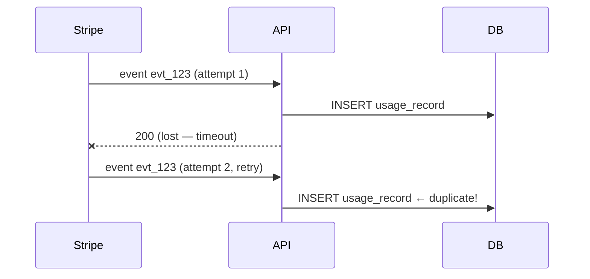

# Fix billing webhook retry logic

## Problem

Stripe retries webhook delivery on timeout, and our handler processes the **same event twice** — customers got double usage records on 2026-07-18 (3 affected accounts, refunded).

## Root cause



The handler is not idempotent: nothing checks whether `evt_123` was already processed.

## Fix

Idempotency via processed-events table with a unique constraint:

```sql
CREATE TABLE processed_events (
  event_id text PRIMARY KEY,
  processed_at timestamptz NOT NULL DEFAULT now()
);
```

Handler flow: `INSERT ... ON CONFLICT DO NOTHING` → only proceed if the row was actually inserted.

## Rollout

| Step | Env | Status |
|------|-----|--------|
| Migration | staging | ✅ done |
| Handler change | staging | ✅ done |
| Replay test (100 dup events) | staging | ⏳ running |
| Production deploy | prod | not yet |

## Verification

- [ ] Replay test: 100 duplicated events → exactly 100 usage records
- [ ] Alert on `processed_events` conflict rate > 5%/h (early signal of Stripe retry storms)
