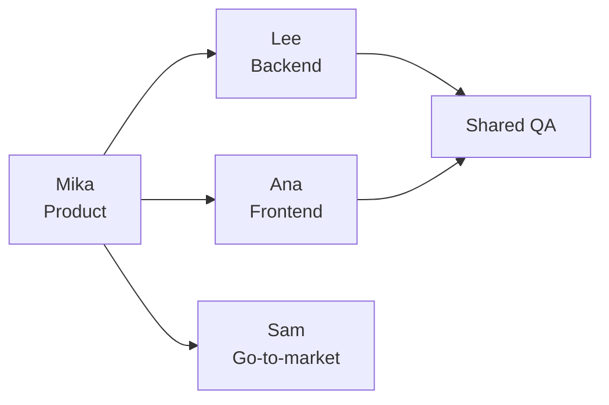

# Kickoff meeting notes

**Date:** 2026-01-15 · **Attendees:** Mika, Sam, Lee, Ana

## Decisions

| # | Decision | Owner | Status |
|---|----------|-------|--------|
| 1 | MVP targets SMB segment first | Mika | ✅ agreed |
| 2 | Usage-based pricing (per seat + metered API) | Sam | ✅ agreed |
| 3 | Beta cohort capped at 20 design partners | Ana | ✅ agreed |
| 4 | Mobile app deferred to 2027 | Lee | ✅ agreed |

## Team structure



## Pricing model (draft)

Monthly revenue per customer is modeled as:

```math
R = S \cdot p_s + \max(0,\; U - U_{free}) \cdot p_u
```

where $S$ = seats, $p_s$ = per-seat price, $U$ = monthly API calls, $U_{free}$ = free tier allowance, and $p_u$ = unit price per call.

Break-even for the beta cohort:

```math
N_{be} = \frac{C_{fixed}}{\bar{R} - c_{var}} \approx \frac{42{,}000}{180 - 35} \approx 290 \text{ customers}
```

## Action items

- [x] Share this note with the wider team
- [x] Book weekly sync (Wed 10:00)
- [ ] Draft PRD for onboarding flow
- [ ] Set up beta partner waitlist form
