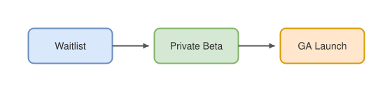
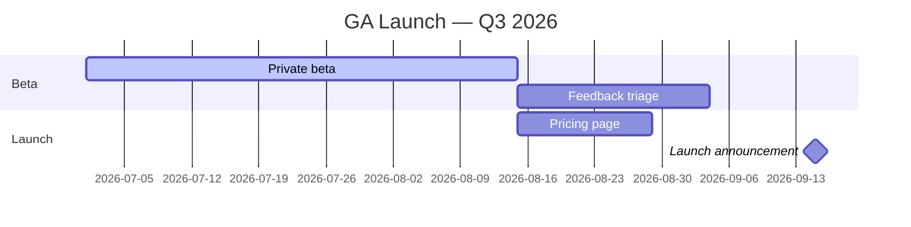

# Launch plan & pricing page

## Rollout funnel

## Timeline


## Pricing tiers
| Tier | Seats | API calls / mo | Price |
| --- | ---: | ---: | ---: |
| Free | 3 | 10,000 | $0 |
| Team | 20 | 250,000 | $49 |
| Business | unlimited | 2,000,000 | $199 |
| Enterprise | unlimited | custom | contact us |

## Conversion target
Expected conversion from waitlist to paid, assuming funnel rates $c_1$ (waitlist → beta) and $c_2$ (beta → paid):

```math
N_{paid} = N_{waitlist} \cdot c_1 \cdot c_2 = 1{,}800 \times 0.35 \times 0.42 \approx 265
```

> **Note:** $c_2 = 0.42$ comes from the design-partner survey (n = 20). Re-validate after the first beta cohort.

## Checklist

- [ ] Pricing page copy review with legal
- [ ] Status page & SLA doc
- [ ] Launch-day on-call rotation
- [x] Domain & SSL for marketing site
