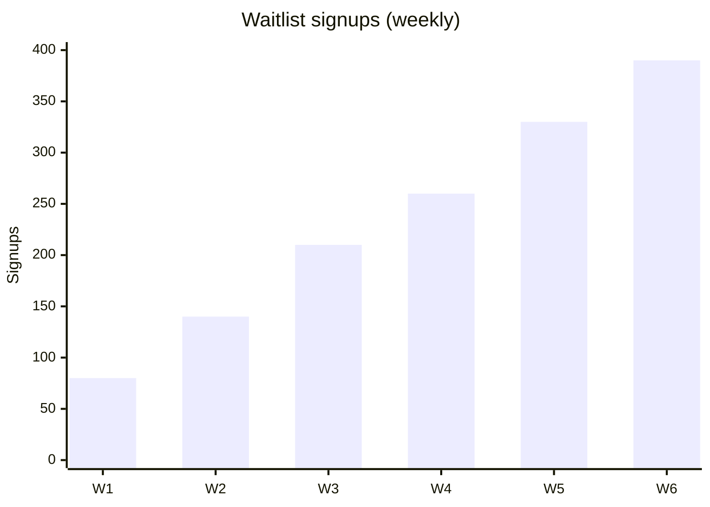

# Meeting Minutes — Weekly Sync

## 2026-07-22

**Attendees:** Mika, Sam, Lee, Ana

### Progress

| Area | Last week | This week | Risk |
| --- | --- | --- | --- |
| Backend | Billing API done | Webhook idempotency | 🟡 |
| Frontend | Signup flow | Onboarding wizard | 🟢 |
| GTM | Waitlist at 1,240 | Partner FAQ | 🟢 |

### Discussion

- Billing webhook duplicates traced to Stripe retry storms — Lee proposes idempotency keys, agreed.
- Ana raised: onboarding wizard needs empty-state designs before beta. Moved up to next week.
- Waitlist growth is ahead of plan:

### Decisions

1. Beta start date **confirmed: 2026-07-01** (no slip).
2. Empty-state design work pulled forward one sprint.

### Next actions

- [ ] Lee — idempotency fix by Friday
- [ ] Ana — empty states in Figma
- [ ] Sam — FAQ draft for review
