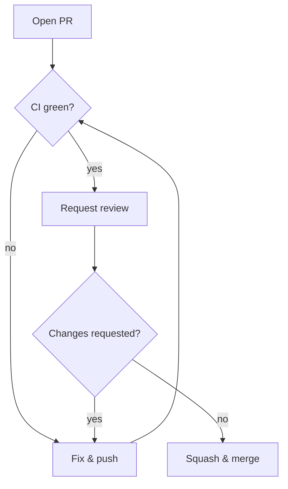

# Coding standards & review process

## Principles

1. **Small PRs** — target ≤ 400 changed lines; split otherwise
2. **Tests with the change** — no "tests later" PRs
3. **One approval to merge**, two for schema migrations or auth code

## Review flow



## Style rules

| Area | Rule |
|------|------|
| TypeScript | `strict: true`, no `any` without a comment |
| React | function components only; hooks for shared logic |
| API | RFC 9457 errors (see Architecture Notes → REST API conventions) |
| Commits | Conventional Commits (`feat:`, `fix:`, `chore:`) |
| Naming | `camelCase` for vars, `PascalCase` for components/types |

## Review SLA

Reviews within one business day. PR size vs review time follows roughly:

```math
T_{review} \approx 5 + 0.08 \times L \;\text{min}
```

so a 400-line PR costs ~37 minutes of a reviewer's day — another reason to keep PRs small.
