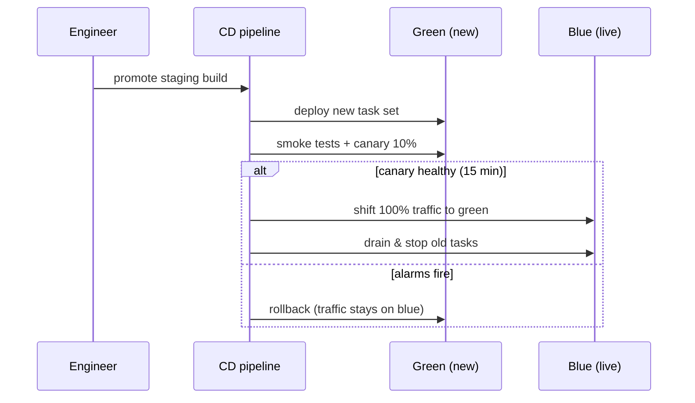

# Deploy & release workflow

## Environments

| Env | Branch | Deploy | URL |
| --- | --- | --- | --- |
| Preview | any PR | automatic per push | `pr-{n}.preview.example.com` |
| Staging | `main` | automatic on merge | `staging.example.com` |
| Production | `main` | manual promote | `app.example.com` |

## Blue/green promote

## Release checklist

- [ ] Staging soak ≥ 2 hours with no new errors
- [ ] DB migrations are backward-compatible (old code must run against new schema)
- [ ] Feature flags default OFF for unfinished work
- [ ] Release notes drafted (see Release Notes md)

## Rollback

One command: `deploy rollback --env prod` — shifts traffic back to the previous task set (kept warm for 24h). Median rollback time in Q2 was **90 seconds**.
