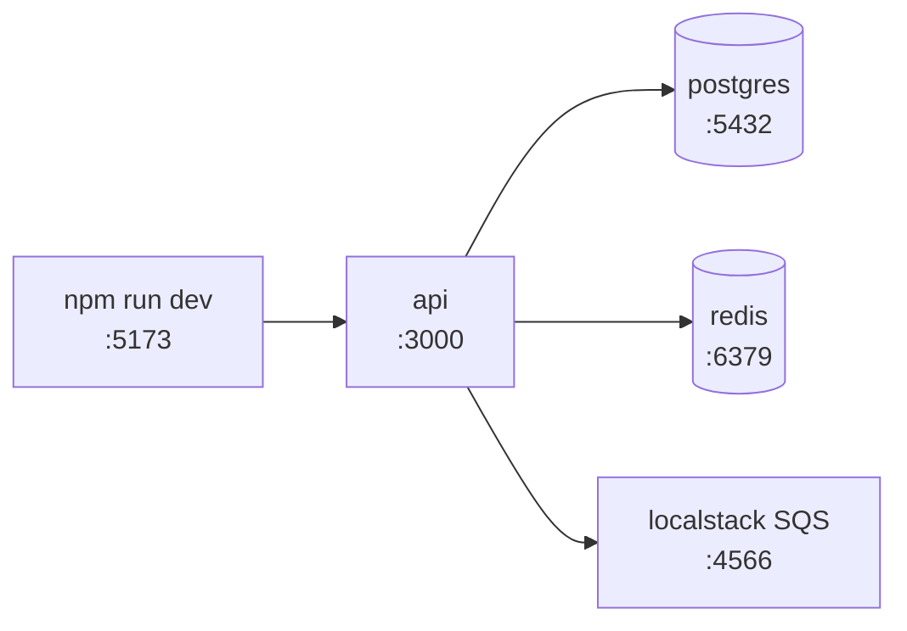

# Local environment setup

## Prerequisites

| Tool | Version | Install |
|------|---------|---------|
| Node | 22 LTS | `mise use node@22` |
| Docker | 27+ | Docker Desktop |
| PostgreSQL client | 16 | `brew install libpq` |

## Steps

```bash
git clone git@github.com:example/webapp1.git
cd webapp1
mise install          # node + tools from .mise.toml
npm install
docker compose up -d  # postgres + redis + localstack
npm run db:migrate
npm run dev           # http://localhost:5173
```

## Service topology (local)



## Troubleshooting

- **Port 5432 already in use** — a local Postgres is running; `brew services stop postgresql`
- **Migrations fail with SSL error** — set `PGSSLMODE=disable` in `.env.local`
- **Slow HMR on macOS** — exclude the repo from Spotlight indexing
