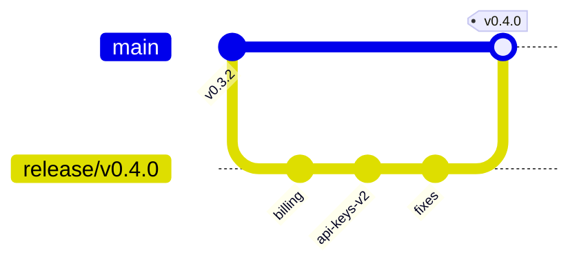

# Release Notes — v0.4.0

**Release date:** 2026-07-24 · **Deploy:** blue/green, zero downtime

## Highlights

- 🚀 **Usage-based billing** — metered API pricing with monthly rollover
- 🔐 **API keys v2** — scoped keys with per-key rate limits
- 🐛 12 bug fixes, 3 performance improvements

## Changes

| Type | Description | PR |
| --- | --- | :---: |
| Feature | Metered billing with Stripe usage records | #482 |
| Feature | Scoped API keys (`read:*`, `write:projects`) | #475 |
| Fix | Duplicate webhook processing under retry | #491 |
| Fix | CLS spike on dashboard skeleton | #488 |
| Perf | Project list renders 3x faster (memoized rows) | #486 |

## Migration notes

Existing API keys keep full scope. To migrate to scoped keys:

```bash
curl -X POST https://api.example.com/v1/keys \
  -H "Authorization: Bearer $ADMIN_KEY" \
  -d '{"scopes": ["read:projects", "write:projects"]}'
```

## Deploy graph



## Error budget

SLO is 99.9% monthly availability. Budget consumed this month:

```math
E = \frac{t_{down}}{t_{total}} = \frac{14 \text{ min}}{43{,}200 \text{ min}} \approx 0.032\% \quad (\text{budget: } 0.1\%)
```

🟢 68% of the error budget remains.
