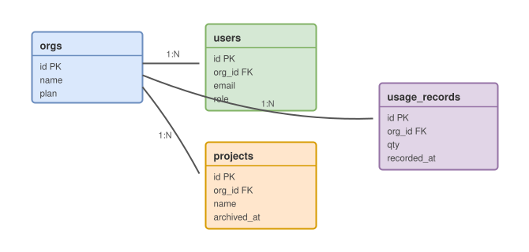

# Database Schema Design

Current schema for the billing-aware core. Diagrams are `.drawio.svg` — **click to edit in draw.io** without leaving Fractal; the file stays a plain SVG that renders on GitHub too.

## Entity relationships



## Tables

| Table | Rows (est.) | Growth | Notes |
| --- | ---: | --- | --- |
| `orgs` | 2 k | slow | one per customer |
| `users` | 18 k | slow | soft-delete via `deleted_at` |
| `projects` | 40 k | medium | archived, never deleted |
| `usage_records` | 90 M | **fast** | partitioned monthly |

## Partitioning strategy

`usage_records` is range-partitioned by `recorded_at` (monthly). Retention math for the 24-month window:

```math
N_{rows} = Q_{month} \times 24 = 3.75\text{M} \times 24 = 90\text{M rows} \approx 41 \text{ GB}
```

Partition pruning keeps the hot billing query (`current month per org`) on a single ~1.7 GB partition.

## Migration rules

- Additive first: new columns are nullable or defaulted, backfilled async
- Old code must run against the new schema (blue/green requirement — see Deploy & release workflow)
- Every migration ships with a `down` script, tested in staging

## Index review (Q3)

- [x] `usage_records (org_id, recorded_at DESC)` — covers billing rollup
- [ ] Drop unused `projects (name)` btree (0 scans in 90 days)
- [ ] Partial index on `users (email) WHERE deleted_at IS NULL`
