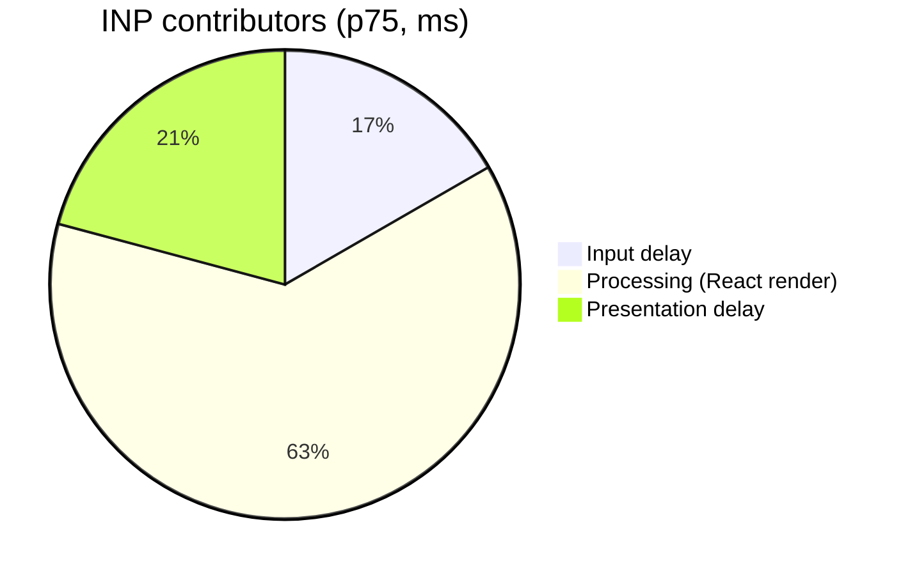

# Performance budget & Core Web Vitals

## Budgets (mobile, p75)

| Metric | Budget | Current | Status |
|--------|-------:|--------:|--------|
| LCP | ≤ 2.5 s | 2.1 s | 🟢 |
| INP | ≤ 200 ms | 240 ms | 🔴 |
| CLS | ≤ 0.1 | 0.04 | 🟢 |
| JS bundle (initial) | ≤ 180 KB | 172 KB | 🟡 |

## INP breakdown



Main offender is the project-list re-render on filter change. Plan: memoize row components + move filtering into a worker.

## Weight math

The initial route must stay under budget even with the analytics snippet:

```math
W_{total} = W_{app} + W_{vendor} + W_{analytics} = 96 + 61 + 15 = 172 \text{ KB} \le 180 \text{ KB}
```

Remaining headroom is $180 - 172 = 8$ KB — any new dependency needs a size review.

## Action items

- [ ] Memoize `ProjectRow` and virtualize the list
- [ ] Defer analytics to `requestIdleCallback`
- [x] Preload hero font (`font-display: swap`)
- [ ] Add bundle-size check to CI (fail > 180 KB)
