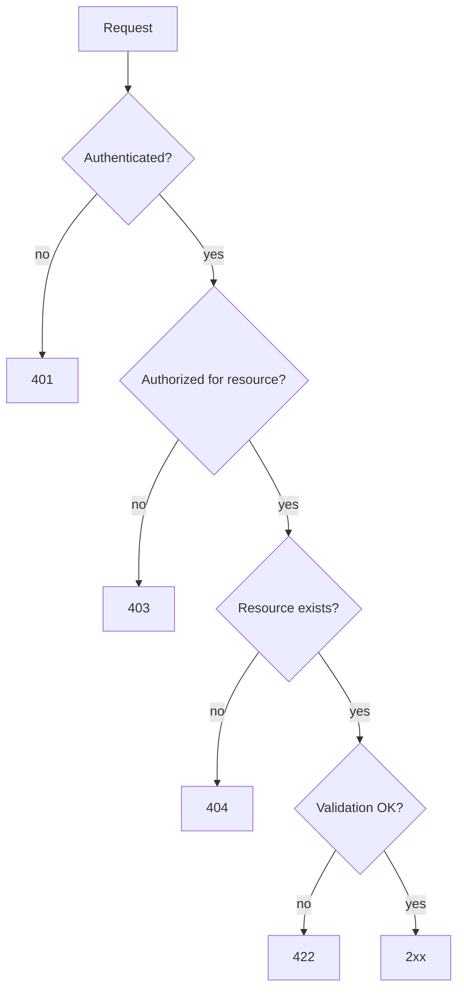

# REST API conventions & error format

## URL structure

| Pattern | Example | Notes |
|---------|---------|-------|
| `/v1/{resource}` | `/v1/projects` | plural nouns |
| `/v1/{resource}/{id}` | `/v1/projects/prj_8f2k` | prefixed IDs |
| `/v1/{resource}/{id}/{sub}` | `/v1/projects/prj_8f2k/members` | one level max |

## Error format

Every error returns RFC 9457 problem details:

```json
{
  "type": "https://api.example.com/errors/rate-limited",
  "title": "Too Many Requests",
  "status": 429,
  "detail": "Rate limit of 100 req/min exceeded.",
  "retry_after": 32
}
```

## Status code decision tree



## Rate limiting

Token bucket per API key. Bucket capacity $B$, refill rate $r$ tokens/sec. A burst of $n$ requests is allowed iff:

```math
n \le B + r \cdot \Delta t
```

Defaults: $B = 20$, $r = 1.67$ (= 100 req/min). Headers returned on every response: `X-RateLimit-Limit`, `X-RateLimit-Remaining`, `Retry-After`.

## Versioning policy

- Breaking changes → new `/v2` prefix, `/v1` supported for 12 months
- Additive changes (new fields) ship without version bump — clients must ignore unknown fields
