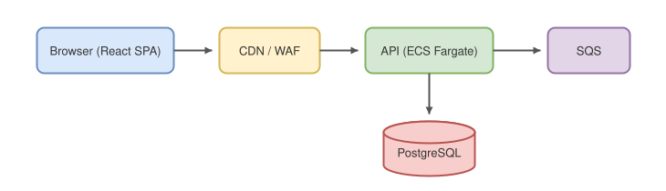
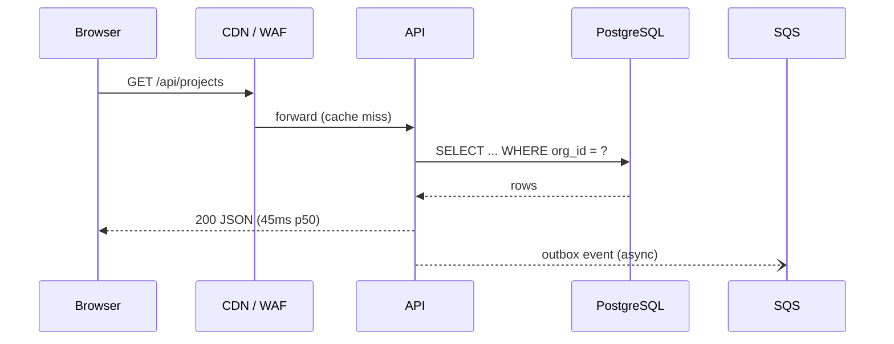

# System architecture overview

## High-level diagram



## Request flow



## Components

| Component | Tech | Scaling | Notes |
|-----------|------|---------|-------|
| SPA | React 19 + Vite | CDN | code-split per route |
| API | Node 22 / Fastify | ECS Fargate, target-tracking | stateless |
| DB | PostgreSQL 16 | 1 writer + 2 read replicas | RDS |
| Queue | SQS | managed | outbox pattern |
| Cache | Redis | ElastiCache | session + rate limit |

## Capacity model

Expected p99 latency under load follows an M/M/c approximation. With arrival rate $\lambda$, service rate $\mu$, and $c$ containers, utilization is:

```math
\rho = \frac{\lambda}{c \, \mu}
```

We autoscale to keep $\rho \le 0.6$. At beta scale ($\lambda = 120$ req/s, $\mu = 40$ req/s per task) that means:

```math
c = \left\lceil \frac{120}{0.6 \times 40} \right\rceil = 5 \text{ tasks}
```

## Non-goals (for MVP)

- Multi-region active-active (single region + backups is enough)
- GraphQL (REST covers current clients)
- Kubernetes (Fargate is operationally simpler at this scale)
